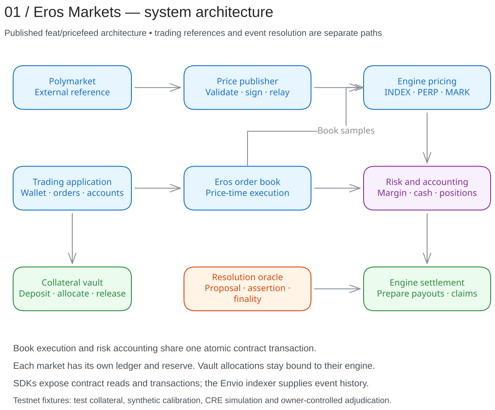
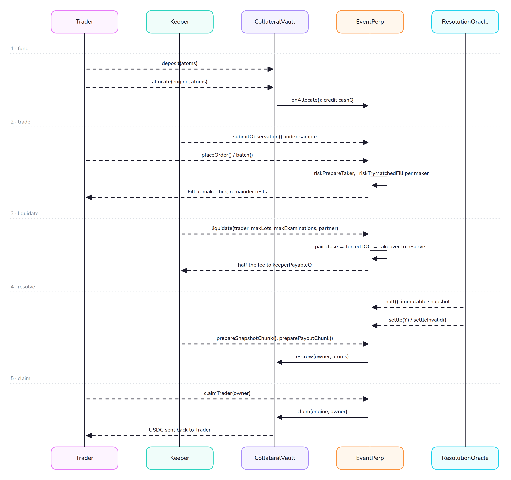

<p align="center">
  <picture>
    <source media="(prefers-color-scheme: dark)" srcset="https://raw.githubusercontent.com/akronim26/eros-markets/main/docs/assets/eros-mark-on-dark.svg">
    
  </picture>
</p>

<h1 align="center">Eros Markets</h1>

<p align="center">Long or short real-world event outcomes. Trade on Monad.</p>

<p align="center">
  <a href="#key-features">Features</a> &middot;
  <a href="#architecture--user-flow">Architecture</a> &middot;
  <a href="#-quick-start">Quick start</a> &middot;
  <a href="#documentation">Documentation</a>
</p>

## Introduction

> **EventPerp isn't just another prediction market, it's leverage that survives the moment of truth. Every event ends in a jump. Most perps can't handle that.**

Eros Markets is a protocol for leveraged binary event trading on Monad. With EventPerp, traders go long or short on an event's YES outcome through an on-chain order book, and every position settles to the real outcome.

A YES token pays 1 USDC if the event happens and 0 if it doesn't, so its price is the market's probability. Trading that probability with leverage is fine while the question is open. At resolution, though, the price jumps straight to 0 or 1 in a single block, no liquidator can act inside that jump, and a leveraged loser can't pay. So leverage has to step down to 1x before the jump, and the losses that remain have to be covered.

EventPerp does both on-chain. A fully on-chain order book feeds a Risk & Clearing engine that prices margin from the event's own hazard rate, keeps a prefunded reserve that covers **both** possible outcomes at every step, and pays out once the oracle finalises.

Eros uses **Polymarket as an external price reference**. Orders execute on Eros, backed by its own makers, collateral and reserves. The external reference informs pricing and risk; it does not route trades to Polymarket or import its liquidity.

Perps on a deadline, done right.

## Key Features

- **Fully On-Chain Order Book**: 999 price ticks (0.001 to 0.999), a 4-word bitmap per side for best-price lookup, FIFO doubly linked levels, and a bounded match loop. LIMIT, IOC and POST_ONLY orders, reduce-only, good-til-block expiry and O(1) cancel-all. Fills and their accounting update atomically.
- **Long and Short Exposure**: Reserve-backed leverage with a configured listing ceiling of up to **5×**. What an account can actually open depends on prices, calibration, collateral, reserves and the market's stage.
- **Both-Outcome Coverage**: The reserve's value at YES and at NO is always at least the traders' worst-case deficits plus the funding budget. That one check covers INVALID too, at any price in between.
- **Hazard-Aware Margin**: Margin comes from a horizon-scaled volatility bound plus a jump-hazard tail term, all rounded against the trader. Missing or expired calibration means 1x, never a guessed default.
- **Separate Trading and Settlement Prices**: INDEX is the averaged external reference. MARK, the price used for risk, also takes eligible Eros book observations and pricing bounds. A separate resolution oracle decides the final outcome.
- **Leverage that Steps Down on a Clock**: Stages run TRADING → BACKING_GRACE (T−12h30m) → BACKING_FLOOR (T−12h) → REDUCE_ONLY (T−1h) → HALTED. From the floor on, every account must be fully backed, and that check reads no price.
- **Three-Step Liquidation**: Pair two eligible accounts at one price, then send a reduce-only IOC into the book, then, only if equity is zero or negative, take over the whole account into the reserve. Running out of liquidity alone never authorises a takeover.
- **Exact Integer Accounting**: Cash is kept in Q (one USDC atom × 10¹⁸), so every fill is exact. No floating point anywhere. Requirements round up and payouts round down.
- **Bounded Settlement**: The oracle's `halt()` and `settle(Y)` run in constant work. Snapshots and payouts are prepared in bounded chunks, and each trader claims once.
- **A Trading Terminal**: Wallet connection, market data, order management, positions and collateral controls, built with Next.js, Privy and viem/wagmi.

## Mathematical Foundation

### The EventPerp Model

The engine follows the Risk & Clearing specification in [`docs/spec/risk_spec.md`](docs/spec/risk_spec.md) (spec v1.1, economic baseline v1.0). The derivations behind it are in [`docs/eventperp-design.md`](docs/eventperp-design.md).

#### Core Mathematical Concepts

**1. The Price Is a Martingale with a Fixed Variance Budget**

$$p_t=\mathbb E[Y\mid\mathcal F_t],\qquad \mathbb E\Big[\sum_k\Delta_k^2\ \Big|\ \mathcal F_t\Big]=p_t(1-p_t)$$

However little time is left, the price still has the same total movement to get through. So it becomes more volatile as resolution approaches. BTC has no such deadline, which is why crypto perps can keep a fixed maximum leverage and EventPerp can't.

**2. Two-Endpoint Equity**

For a signed position `n` in lots and cash `c` in Q:

$$E_0=c,\qquad E_1=c+1000Q\,n,\qquad E(p)=c+1000\,n\,p_{Wad}$$

An account is fully backed exactly when `E0 ≥ 0 && E1 ≥ 0`. This test reads no price, so it still works when the price feed doesn't.

**3. Outcome Coverage**

Net positions are zero, so total assets `A = r + Σ eᵢ`. Positive trader payouts therefore total `A − r + D`, where `D` is the total trader deficit. If the reserve value `r ≥ D`, payouts never exceed assets. The engine checks this separately for NO and YES:

$$R_y\ \ge\ \bar D_y + B\qquad (y=0,1)$$

The sum of positive parts is convex in price, so covering both endpoints also covers every INVALID price between them.

**4. Margin Kernel**

With adverse hazard bound `a_adv`, confidence `ε = 0.01`, horizon `h = h₀ + |x|/v`, and directional worst-case loss `w` (`q` for a long, `1 − q` for a short):

$$\epsilon'=\frac{\epsilon-a_{adv}}{1-a_{adv}},\quad k=\sqrt{\frac{1-\epsilon'}{\epsilon'}},\quad \sigma_h=\max\Big(\sqrt{\tfrac{q(1-q)h}{T-t}},\ \sigma_{realized},\ \sigma_{template}\Big)$$

$$MM=\min\big(|x|w,\ |x|(m_{side}+k\sigma_h+s)+\tfrac12\lambda x^2\big),\qquad IM=\min\big(|x|w,\ \max(\gamma MM,\ |x|w/L_{cap})\big)$$

Requirements, hazards and `k` round up; `ε'` rounds down. If `a₀ + a₁ ≥ 1`, if the adverse hazard reaches `ε`, or if `ε'` rounds to zero, the kernel returns `fullBackingRequired`. It never divides by position size or by equity.

**5. Q Fixed-Point Units**

We use one Q = one USDC atom × 10¹⁸ for internal cash. One lot is 0.001 claim and pays exactly `1000·Q` on YES, so a fill at tick `t` moves exactly `lots · t · Q`. Custody and transfers stay in six-decimal USDC atoms. Fractional Q is never rounded up into a withdrawable atom.

**6. Lot and Tick Geometry**

Each order is defined by:
- **tick**: 1 to 999, price = tick / 1000
- **lots**: size in 0.001-claim units, with positions bounded by 2⁴⁰ lots
- **epochs**: the market and account order epochs, so a stale order can never release a newer reservation

## What We Changed from the Source Specs

### Core Protocol

1. Cash settlement ships first. Conversion to outcome tokens is a separate, disabled extension (DEC-10).
2. Funding runs on fixed-rate hourly epochs with a bounded mandatory sweep and no historic catch-up (DEC-02). The current integration turns periodic funding payments and payout haircuts off.
3. Every maker is rechecked on every paired fill, and resting orders reserve a conservative initial-margin envelope (DEC-05).
4. Closing out an account means a whole-account takeover (cash **and** position) into the reserve, never a cash bad-debt payment. That is the only closeout that provably keeps both outcome slacks non-negative (DEC-13).
5. INVALID settles at the scheduled `[T−24h, T]` index TWAP. A one-hour missing-data grace and a fixed 0.5 fallback are disclosed at listing (DEC-08).
6. Each market keeps a bounded participant list (1,024 traders in v1), so halt and checkpoint work is bounded (DEC-12).

### Order Book

1. One book per market engine, with no market id on any hook.
2. Expected failures come back as statuses (`PRUNE_MAKER`, `STOP_TAKER`, rejection codes) instead of reverts.
3. An order slot is retired, not recycled, when its generation reaches 255, so an order id is never reissued.
4. The fill bound is set per market from measured gas, not hardcoded.

The full list is in [`contracts/README.md`](contracts/README.md#where-this-differs-from-the-spec) and the DEC-01 to DEC-14 table in the spec.

## Current Status

**Development / Monad testnet, as of 11 October 2026.**

The published integration branch [`feat/pricefeed`](https://github.com/akronim26/eros-markets/tree/feat/pricefeed) contains the contracts, price publisher, resolution services, SDKs, indexer and trading application. Recorded local tests exercise leveraged trading through settlement and payout checks. Monad testnet deployment records include market creation, reserve funding and operator startup; those records do not establish that markets are currently available for trading.

The latest pricing startup improvements have been validated locally and need a replacement deployment to reach existing testnet markets. An hourly MARK-availability gap remains documented. See the [implementation status](https://github.com/akronim26/eros-markets/blob/feat/pricefeed/README.md#implementation-status) and [startup findings](https://github.com/akronim26/eros-markets/blob/feat/pricefeed/docs/integration/FAST_MARK_STARTUP.md).

The implementation uses test collateral and synthetic risk calibration. It is not production-ready or independently security-audited, and the 5× listing ceiling does not guarantee executable 5× positions.

## Contract Addresses

Monad testnet (chain ID 10143). The order book and risk engine are one contract, `BookRiskEngine`; there is no separate order-book address.

- **Deployment inventory on this branch**: [`addresses.md`](addresses.md)
- **Latest deployment records**: [`feat/pricefeed/addresses.md`](https://github.com/akronim26/eros-markets/blob/feat/pricefeed/addresses.md)

These are testnet fixtures, not production collateral or a production oracle integration.

## Architecture & User Flow



| Layer | Role |
| --- | --- |
| Contracts | Order matching, margin checks, collateral accounting, liquidation and settlement |
| Price publisher | Collects Polymarket observations, validates source data and publishes signed prices |
| Resolution services | Market registry, outcome resolution and adjudication |
| Market operators | Maintain price publication, book sampling, accounting progress and funded quotes |
| SDKs and indexer | Contract interfaces, read models and event history |
| Trading application | Market discovery, wallet transactions, orders and account views |

The call sequence through one market's life (fund, trade, liquidate, resolve, claim):



The sequence diagram's source is [`docs/assets/architecture.excalidraw`](docs/assets/architecture.excalidraw); open it at [excalidraw.com](https://excalidraw.com). To change it, edit `docs/assets/gen_architecture.py` and run `python3 docs/assets/gen_architecture.py`.

Inside the contracts:

| Module | Where | Owns |
|---|---|---|
| Order book | `contracts/src/Book.sol` | order ids, FIFO levels, matching, cancels |
| Risk & Clearing | `contracts/src/risk`, `contracts/src/math` | cash, positions, margin, funding, premium, reserve coverage, liquidation, stages |
| Pricing | `contracts/src/pricing` | authenticated observations, 300 s impact-mid TWAP index, mark |
| Vaults | `contracts/src/vaults` | USDC custody (`CollateralVault`), reserve shares (`ReserveVault`), `BackstopPool` |
| Settlement | `contracts/src/settlement` | halt snapshot, INVALID price capture, payout preparation, claims |
| Resolution oracle | separate team | evidence, voters, disputes; calls only `halt` / `settle` / `settleInvalid` |

## 🚀 Quick Start

### Prerequisites

- Foundry 1.8.3
- Python 3 (reference engine, standard library only)
- Node.js 22.x (frontend)
- Git

### Contracts

```bash
# Clone the repository
git clone --recursive https://github.com/akronim26/eros-markets.git
cd eros-markets/contracts

# Build the project (also checks contract sizes against Monad's 128 KiB limit)
forge build --sizes

# Run tests
forge test
```

### Deeper test runs

```bash
# 10k fuzz runs, 256×128 invariant (~6–8 min), as CI runs it
FOUNDRY_PROFILE=ci forge test

# Gas snapshot must not change
FORGE_SNAPSHOT_CHECK=true forge test --mc BookGasTest

# One task's acceptance check against the exact Fraction reference (from the repo root).
# It rewrites that task's evidence file in artifacts/tasks/.
bash scripts/check-task.sh A010
```

### Frontend

The complete application lives on [`feat/pricefeed`](https://github.com/akronim26/eros-markets/tree/feat/pricefeed):

```bash
git clone --branch feat/pricefeed --recurse-submodules https://github.com/akronim26/eros-markets.git
cd eros-markets
npm ci --prefix frontend
cp frontend/.env.example frontend/.env.local
npm run dev --prefix frontend
```

Open the URL printed by Next.js, normally `http://localhost:3000`. The frontend uses the configured Monad testnet deployment. Set `NEXT_PUBLIC_PRIVY_APP_ID` in `frontend/.env.local` and allow your local origin in Privy to enable wallet login; without it, public reads work and wallet actions are disabled. Credential-bearing RPC URLs belong in the server-only `MONAD_RPC_URL`.

Starting the frontend does not start publishers, makers, keepers or the indexer, and market data depends on them. For a disposable local backend with test collateral and a full settlement scenario, follow the [integrated backend setup](https://github.com/akronim26/eros-markets/blob/feat/pricefeed/README.md#exercise-the-integrated-backend-locally).

### How to test

1. `contracts/test/Book*.t.sol`: the book on its own. Bitmap, FIFO, matching, batch, invariants, and a differential test against a naive reference book.
2. `contracts/test/BookRiskEngine.t.sol`: the real risk engine on the real book, including the worked 5x entry and a liquidation close as a forced IOC.
3. `contracts/test/math`, `contracts/test/risk`, `contracts/test/integration`: per-task suites, checked against vectors from the `reference/` Python engine (`fractions.Fraction`, no floats).

## Documentation

### Specification Reference

This implementation follows [`docs/spec/risk_spec.md`](docs/spec/risk_spec.md), with the counterpart contracts in [`docs/spec/book_interface.md`](docs/spec/book_interface.md) and [`docs/spec/oracle_interface.md`](docs/spec/oracle_interface.md).

### Guides

| Guide | Start here to… |
| --- | --- |
| [Technical README](https://github.com/akronim26/eros-markets/blob/feat/pricefeed/README.md) | Explore implementation details, prerequisites and validation commands |
| [Pricing and market readiness](https://github.com/akronim26/eros-markets/blob/feat/pricefeed/README.md#pricing-and-market-readiness) | Understand INDEX, MARK, warm-up and operating requirements |
| [Risk and collateral](https://github.com/akronim26/eros-markets/blob/feat/pricefeed/docs/integration/LEVERAGE_INTEGRATION.md) | Understand reserve policy, calibration and leverage constraints |
| [Deployment records and addresses](https://github.com/akronim26/eros-markets/blob/feat/pricefeed/addresses.md) | Locate recorded testnet contracts and deployment identities |
| [Local E2E testing](https://github.com/akronim26/eros-markets/blob/feat/pricefeed/docs/integration/E2E_TESTING.md) | Connect backend and browser fixtures for lifecycle testing |
| [SDK and frontend interface](https://github.com/akronim26/eros-markets/blob/feat/pricefeed/oracle/packages/oracle-sdk/FRONTEND_HANDOFF.md) | Integrate contract reads, transaction flows and account states |

### Key Concepts from the Spec

1. **Mutation Envelope**: Every account-changing call authenticates, accrues funding, freezes one price snapshot, touches the affected accounts, then checks margin and coverage.
2. **Risk Hook Seam**: The book calls `_riskPrepareTaker`, `_riskTryMatchedFill`, `_riskConvertPermitToRest`, `_riskOnUnrest` and `_riskFinishTaker` internally, with no external calls in the match loop.
3. **Bootstrap Pricing**: An empty book trades only fully backed orders against the independent index until all three mark windows are valid.
4. **Integration Gates**: G0 to G7 are the integration stops recorded in [`docs/spec/integration_gates.json`](docs/spec/integration_gates.json).

### Development Team

- [@0xr10t](https://github.com/0xr10t)
- [@akronim26](https://github.com/akronim26)
- [@YASH-ai-bit](https://github.com/YASH-ai-bit)
- [@xipharis](https://github.com/xipharis)

## 📄 License

The source files carry `SPDX-License-Identifier: MIT`.

*Built with ❤️ by Eros Markets*
