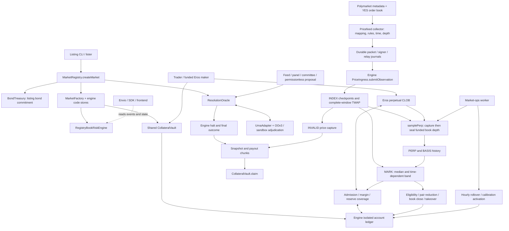
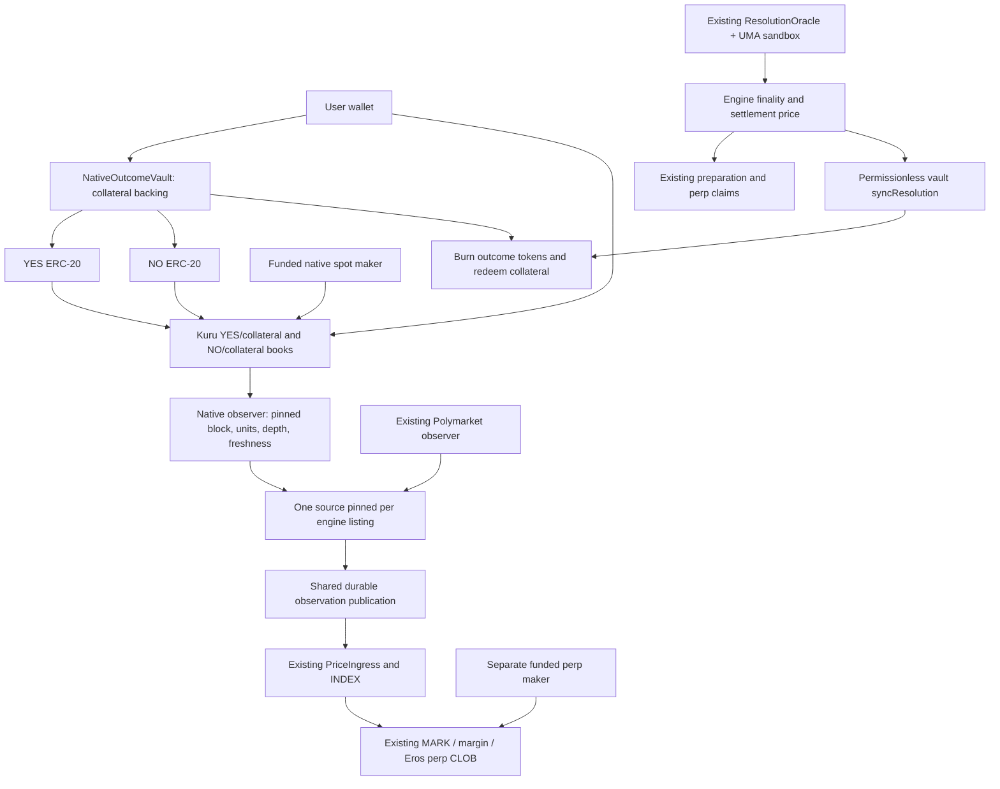

# Eros native market: architecture and hackathon delivery plan

Planning date: 2026-10-13. Repository baseline: `feat/pricefeed` at `df8b01cddc8c66ef636fb83403a0df1893d8fc66`.

Execution status, task dependencies, acceptance checks and demo gates are maintained in [NATIVE_MARKET_TRACKER.md](NATIVE_MARKET_TRACKER.md).

This plan implements the requirements in [nativemarket.md](../../nativemarket.md). It is a design and delivery plan; the proposed native contracts, adapters, and tests are not implemented by this document. Existing untracked files were preserved. No public-chain transactions or deployments were performed, and existing test results were not rerun or presented as fresh validation.

Evidence labels used below:

- **VERIFIED FACT — repository:** behavior traced through the cited implementation, at the baseline above.
- **VERIFIED FACT — documentation:** behavior described by linked primary vendor documentation, consulted on the planning date; this does not establish a successful integration with our deployment.
- **DESIGN RECOMMENDATION:** a proposed implementation or operating policy.
- **ASSUMPTION:** an input that still needs verification; its verification gate is stated.

## 1. Reconstructed current system

This section describes the existing code before introducing the proposed architecture.



### 1.1 Creation, identifiers, and source mapping

**VERIFIED FACT — repository:**

| Concern | Execution path and implication |
| --- | --- |
| Market identity | [oracle-cli `list.ts`](../../oracle/packages/oracle-cli/src/list.ts), `packDir` and listing preparation, derive `bytes32 marketId = keccak256(UTF8(slug))`. Contracts accept a unique nonzero ID; this is not a Polymarket condition ID or a token address. Namespace off-chain records by chain, registry, and market ID. |
| Listing | [MarketRegistry.sol](../../oracle/src/MarketRegistry.sol), `createMarket`, validates timing/feed/AI/assertion configuration, commits listing bond capital, calls `_deployEngine`, stores configuration, and calls `initResolution`. Listing is restricted to `lister`. |
| Engine deployment | [MarketFactory.sol](../../contracts/src/factory/MarketFactory.sol), `deployMarket`, reconstructs pinned creation code from code stores, deploys, checks `listingHash`, and registers the engine in the collateral vault. `engineInit` must be empty. |
| Registry authority | `MarketRegistry._deployEngine` supplies registry, oracle, monitor, times, event `rulesHash`, resolution `sourceHash`, and INVALID policy. The supplied listing retains INDEX source/signer/rules and pricing fields. Event `sourceHash` and INDEX `indexRulesHash` have different meanings. |
| Perpetual engine | [RegistryBookRiskEngine.sol](../../oracle/src/integration/RegistryBookRiskEngine.sol) extends [BookRiskEngine.sol](../../contracts/src/engine/BookRiskEngine.sol), checks registry binding and OI caps after fills and when assessing priceable depth. |
| External mapping | [pricefeed `config.ts`](../../packages/pricefeed/src/config.ts) records event ID, external market ID, condition ID, outcome token ID, and label separately. [collector.ts](../../packages/pricefeed/src/collector.ts), `metadataIdentity`, `verifyEventMembership`, and `inspectSnapshot`, check their correspondence and reject changed identity/rules/status. |
| Source identity | [IMarketConfig.sol](../../contracts/src/interfaces/IMarketConfig.sol) pins `indexSourceId`, `indexSigner`, and `indexRulesHash` at listing. [PriceIngress.sol](../../contracts/src/pricing/PriceIngress.sol) configures a signer once; no source rotation function exists there. Only `_indexSourceId` contributes to INDEX, despite the source-state mapping. |

### 1.2 Price source → INDEX → PERP/BASIS → MARK

1. [Worker.collect](../../packages/pricefeed/src/worker.ts) obtains Polymarket metadata and a book snapshot. [summarizeBook](../../packages/pricefeed/src/book.ts) walks both sides to an explicit quantity, applies depth/spread checks, and uses integer rounding. The normal signed policy is before-fee bid VWAP rounded down, ask VWAP rounded up, and midpoint rounded down; [rules.ts](../../packages/pricefeed/src/rules.ts) binds this policy and the external mapping.
2. [DurablePipeline](../../packages/pricefeed/src/durable-pipeline.ts), [publication.ts](../../packages/pricefeed/src/publication.ts), [PacketStore](../../packages/pricefeed/src/packet-store.ts), and [DurableObservationSigner](../../packages/pricefeed/src/durable-observation-signer.ts) persist preparation, sequence reservation, signing, relay, and receipt state. The pipeline currently parses Polymarket-specific config/rules; replacing only the HTTP fetcher is insufficient.
3. [PriceIngress._ingest](../../contracts/src/pricing/PriceIngress.sol) checks market, configured source, rules hash, signer, strictly increasing sequence, nondecreasing source time, and `observedAt <= publishedAt <= block.timestamp`. The raw signed digest binds the chain and engine. It recomputes depth validity and the midpoint from the signed summary. It does **not** independently fetch the venue or prove that reported depth exists. Delayed data retains its original observation time.
4. [ObservationStore](../../contracts/src/pricing/ObservationStore.sol), `_append`, `_windowTwap`, and `_recordPerp`, keeps three 1,024-checkpoint rings with cumulative time integrals. Availability requires complete coverage of the requested window. A same-second observation replaces the checkpoint without adding elapsed weight. An invalid checkpoint contributes no coverage.
5. [BookRiskEngine.samplePerp](../../contracts/src/engine/BookRiskEngine.sol) captures eligible Eros perp depth, then seals it on a later block only if its book/account/epoch/risk/index commitments remain consistent. A valid pending capture also needs a source observation strictly newer than the capture. [BookDepthSampler.sol](../../contracts/src/pricing/BookDepthSampler.sol) supplies the book scan; `_depthOrderEligibility` counts fully backed eligible orders. A single keeper call or an arbitrary last trade is insufficient.
6. At sample time, `BASIS = perp impact midpoint − contemporaneous INDEX point`. [RiskPricing._markInputs](../../contracts/src/pricing/RiskPricing.sol) reads INDEX TWAP, BASIS TWAP, PERP TWAP, and the latest fresh recorded PERP observation. That last candidate is not an unsampled book quote.
7. [PricingMath.mark](../../contracts/src/math/PricingMath.sol) computes `median(INDEX + BASIS_TWAP, PERP_TWAP, latest_PERP)` and clamps it to `[INDEX − b(t), INDEX + b(t)]` and `[0,1]`, where `b(t) = 0.05 × max(T−t,0)/(T−listedAt)`. All candidates must be available. `RiskPricing` exposes a normal MARK only in `NORMAL_PRICING`.

Current source-code timing, from `PricingMath`:

| Runtime chain | INDEX window | PERP window | BASIS window | INDEX carry | PERP/BASIS carry | Initial promotion |
| --- | ---: | ---: | ---: | ---: | ---: | --- |
| Monad testnet `10143` | 60 s | 60 s | 60 s | 120 s | 300 s | `activatePricing()` when active, accounting READY, and every candidate valid; eligible epoch opening also works |
| Other chains, including local `31337` | 300 s | 60 s | 900 s | 30 s | 30 s | Eligible completed epoch opening |

The README's blanket 30-second carry statement is stale relative to this baseline. `pricingWindows()` reports INDEX carry, not both carry values. Use verified runtime identity and the corresponding implementation to establish book carry. Existing deployments may contain older bytecode. [TestnetPricingWindows.t.sol](../../contracts/test/risk/B/TestnetPricingWindows.t.sol) exercises the chain-specific behavior, but was not run for this planning review.

### 1.3 Bootstrap, accounting, funding, margin, liquidation, and settlement

| Area | Existing behavior and code evidence |
| --- | --- |
| Bootstrap | `BookRiskEngine` initializes an uncalibrated 1× profile. On testnet, `OrderAdmission._warmupRestDecision` permits fully backed, noncrossing post-only quotes around a fresh authenticated INDEX point. Fills still need a valid INDEX window. `activatePricing()` does not activate staged calibration. See [OrderAdmission.sol](../../contracts/src/risk/OrderAdmission.sol), [RiskPricing.sol](../../contracts/src/pricing/RiskPricing.sol). |
| Rollover | [RiskAccountingBridge.sol](../../contracts/src/engine/RiskAccountingBridge.sol), `beginRollover`, `rollPage`, `finishRollover`, wraps [EpochRollover.sol](../../contracts/src/risk/EpochRollover.sol). The sweep invalidates old order epochs, processes bounded account pages, and reopens accounting. Quotes and histories must recover afterward. Clock boundaries are hourly. |
| Funding | Funding rate math and accounting exist in [PricingMath.sol](../../contracts/src/math/PricingMath.sol), [FundingAccounting.sol](../../contracts/src/risk/FundingAccounting.sol), and `_openingRate` in `RiskAccountingBridge`. The concrete `BookRiskEngine` constructor rejects `fundingEnabled=true`; `_openingRate` therefore returns zero in this integration. Native pricing must not be presented as enabling funding. Reserve premiums are a separate accounting mechanism. |
| Freshness/movement | [SourceGuards.sol](../../contracts/src/pricing/SourceGuards.sol) tracks carry and latches funding coverage gaps; a valid observation does not erase a historical gap. A movement over 0.10 versus an available point 300 seconds earlier sets a restriction. This is not a complete manipulation defense. |
| Collateral | [CollateralVault.sol](../../contracts/src/vaults/CollateralVault.sol), `deposit → allocate`, provides shared custody with isolated engine allocations. [ClearingCore.sol](../../contracts/src/risk/ClearingCore.sol), `onAllocate`, `release`, `_pairedFill`, connects owner balances, risk and coverage checks, and atomic fills. Release returns free vault balance; withdrawal is separate. |
| Margin/coverage | [OrderAdmission.sol](../../contracts/src/risk/OrderAdmission.sol), `_takerDecision` and `_admitWith`, checks action state, order bounds, reductions, health, and reserve coverage. [MarginMath.sol](../../contracts/src/math/MarginMath.sol) and [CoverageMath.sol](../../contracts/src/math/CoverageMath.sol) distinguish account risk from terminal deficit backing. Maker liquidity, reserve capital, and user margin are different requirements. |
| Leverage | Listing ceiling can be at most 5×, but initial profile is 1×. Higher effective leverage requires valid calibration activated at an epoch, current pricing, collateral, reserve cover, and lifecycle eligibility. `RegistryBookRiskEngine.marketOiCapLots` also constrains capacity. |
| Liquidation | [LiquidationEligibility._eligibility](../../contracts/src/risk/LiquidationEligibility.sol) and [RiskLiquidation.liquidate](../../contracts/src/risk/RiskLiquidation.sol) synchronize accounts, determine eligibility, then cancel commitments and execute permitted takeover, pair reduction, or bounded book close. Stale MARK alone never authorizes ordinary MARK-based liquidation. Price-free endpoint/floor cases remain separate. |
| Lifecycle | [LifecycleMath.sol](../../contracts/src/math/LifecycleMath.sol) and [FloorLifecycle.sol](../../contracts/src/risk/FloorLifecycle.sol) enforce full backing for new commitments from T−12h30m, the backing-floor stage from T−12h, reduce-only from T−1h, and halt at T or an authenticated early halt. |
| Resolution | [ResolutionOracle.sol](../../oracle/src/ResolutionOracle.sol) routes feed, panel, committee, and permissionless proposals through assertions and adjudication. [UmaAdapter.sol](../../oracle/src/venues/UmaAdapter.sol), `assertOutcome`, `trySettle`, and `statusOf`, interfaces with same-chain OOv3. `finalizeMarket`/internal finalization delivers engine finality atomically; `voidMarket` can result in INVALID. |
| Settlement | [ResolutionIngress.sol](../../contracts/src/settlement/ResolutionIngress.sol) authenticates halt/finality. [SettlementController.sol](../../contracts/src/settlement/SettlementController.sol) requires snapshot chunks, final outcome and price, payout chunks, and reconciliation before claims. `CollateralVault.claim` pays the owner. Token conversion is not the native-token implementation. |
| INVALID | [InvalidPrice.captureInvalidPrice](../../contracts/src/settlement/InvalidPrice.sol) captures the complete `[T−24h,T]` INDEX TWAP; if incomplete and disclosed, it waits until T+1h and captures the listed 0.5 fallback. Thus INVALID is not universally 0.5. Finality, price readiness, and claims readiness are separate. |

### 1.4 Current services and missing native functionality

**VERIFIED FACT — repository:** the tree uses `contracts/src`, `oracle/src`, `packages/pricefeed/src`, `frontend/src`, `oracle/services`, and `scripts`; there is no root application `src/` or `workers/` implementation to reuse blindly.

| Existing component | Reuse in native delivery |
| --- | --- |
| [Pricefeed package](../../packages/pricefeed/README.md) | Book arithmetic, signed envelope, packet/signing/transaction journals, receipt verification, RPC and gas controls; adapt Polymarket-specific validation boundaries explicitly. |
| [market-ops](../../oracle/services/market-ops/README.md) and [keeper-observer.ts](../../scripts/e2e/keeper-observer.ts) | Perp sampling, activation/rollover coordination, configured liquidation monitoring. |
| [makers.mjs](../../scripts/e2e/makers.mjs) | Funded **perp** depth. It is not a Kuru spot maker. |
| [market-supervisor.mjs](../../scripts/ops/market-supervisor.mjs) | Bounded restart policy, durable worker enrollment, gas runway; add native-worker support. Disable wake-on-visit shutdown for the native demo while price history or resolution work is required. |
| [Oracle services](../../oracle/services/README.md) | Keeper, snapshotter, panel runner, watchdog, committee console, market-ops, and local integration services; select the existing minimal resolution route. |
| [Oracle workflows](../../oracle/workflows) | CRE listen/resolution/dry-run machinery already exists; no new native-specific oracle network is needed. |
| [SDK](../../oracle/packages/oracle-sdk/src) and [risk SDK](../../packages/risk-sdk/README.md) | Verified manifests, engine transactions, state reads, and accounting views. |
| [Frontend deployment config](../../frontend/src/config/deployment.ts) and [market discovery](../../frontend/src/lib/market-discovery.ts) | Existing wallet/terminal; discovery enables transactions only for verified manifests. Current labels assume external Polymarket, so native provenance needs an explicit update. |
| [Envio indexer](../../oracle/indexer) | Existing perp/oracle history. Add native issuance/redemption entities only after the vertical slice; direct receipts and pinned state reads suffice initially. |
| [local-stack.py](../../scripts/integration/local-stack.py), [RealMarketFixture.sol](../../oracle/test/integration/RealMarketFixture.sol) | Lifecycle deployment and audit patterns; use isolated native fixtures and journals. |

No tracked Kuru integration or native outcome-token/vault implementation was found. `scripts/native-demo/` and `scripts/native-sim/` contain Python bytecode caches, not tracked implementation source. The [September theory design](../superpowers/specs/2026-09-29-eventperp-theory-design.md) mentions native ERC-20s and Kuru, but its older INDEX, MARK, liquidation, and funding descriptions do not describe the current engine. The [sponsor plan](../SPONSOR_INTEGRATION_PLAN.md) also describes proposed Kuru work rather than completed integration.

## 2. Architecture decision

**DESIGN RECOMMENDATION — build now:** add one binary native event with a dedicated fully backed outcome vault, two standard ERC-20 outcome tokens, YES/collateral and NO/collateral Kuru spot books, and one native observer feeding the existing signed observation interface. Reuse the existing registry/factory/perp engine/oracle stack. Pin one INDEX source per market at creation. Keep existing external markets operating alongside native markets.

Start with a 1× native-priced perp and test collateral. Native leverage above 1× is a separate stretch milestone with liquidity, calibration, reserve, and price-independence evidence. Periodic funding remains disabled. This still demonstrates issuance, user spot execution, observable spot prices, native INDEX/MARK, perp trading, and coordinated settlement.

**ASSUMPTIONS:** Monad testnet `10143`, one event, one six-decimal collateral token matching the chosen Eros vault, a few funded demo accounts, and a single operator host. No deadline or team size was provided; estimates below are engineering effort, not a promised calendar date.



There is no native-spot-price dependency on Eros MARK or the Eros perp book. Perp makers may reference native INDEX; the native maker must not reference that perp's MARK/INDEX to create its own source price.

### 2.1 Alternatives and weighted decision matrix

Scores are **design judgments**, 1 = poor and 5 = strong. Weighted total is `Σ(weight × score)/100`. Feasibility and integration time account for 45%; scores assume each venue passes its initial compatibility gate.

| Criterion | Weight | A: ERC-20s + Kuru | B: ERC-20s + existing constant-product AMM implementation | C: Conditional Tokens + existing prediction AMM | D: Extend Eros into a spot CLOB |
| --- | ---: | ---: | ---: | ---: | ---: |
| Delivery speed / amount of new code | 30 | 4 | 3 | 3 | 1 |
| Integration difficulty / time uncertainty | 15 | 3 | 3 | 2 | 1 |
| Reuse of current Eros code | 15 | 5 | 5 | 4 | 3 |
| Demo quality | 15 | 5 | 4 | 4 | 4 |
| Accounting/security simplicity | 15 | 3 | 3 | 4 | 2 |
| External service independence | 5 | 2 | 4 | 4 | 5 |
| Future extensibility | 5 | 5 | 4 | 4 | 4 |
| **Weighted total / 5** | **100** | **3.95** | **3.55** | **3.40** | **2.25** |

- **A — recommended:** new issuance/redemption contracts and Kuru integration; high reuse of the price/risk pipeline. Dependencies are Kuru deployment compatibility, gas, collateral and makers. Best fit to the desired demo if the first gate passes.
- **B — contingency:** keep the same outcome vault/tokens and use a pinned, understood ERC-20 constant-product pool implementation. Integration replaces Kuru book reads with executable buy/sell quotes at depth N. Risks include reserve-ratio manipulation, thin liquidity, LP withdrawal, fees and a new deployment review. This is an alternative workstream, not a one-hour fallback or a second venue to build in parallel. A usable Monad deployment has not been verified in this review.
- **C — credible if Kuru is dropped:** reuse Conditional Tokens and its prediction-market AMM ecosystem. Less custom token accounting, but introduces ERC-1155 IDs, oracle payout reporting, older dependency/toolchain integration, and wrappers if Kuru is later required. Gnosis publishes [Conditional Tokens AMM contracts](https://github.com/gnosis/conditional-tokens-market-makers); availability of source is not validation of an Eros deployment.
- **D — reject for this hackathon:** Eros has a derivative CLOB whose hooks operate on isolated cash/position ledgers. Turning it into escrowed transferable-outcome spot trading requires custody, matching, withdrawals, and new invariants. Reusing matching code would not make that conversion small.

Kuru already combines book execution with AMM liquidity; a separate Eros matching/AMM hybrid is unnecessary. A permissioned fixed-price RFQ could demonstrate token transfer, but would not satisfy the intended native price-discovery demo.

### 2.2 Smallest useful abstraction boundary

| Candidate | Current support | Hackathon decision |
| --- | --- | --- |
| `PriceSource` | Existing on-chain `IPriceSource.Observation` | Reuse unchanged. |
| `ObservationSource` | Collection/publication types embed Polymarket | Add a small off-chain discriminated source policy for `polymarket` and `kuru-native`; both produce the same normalized book summary and observation envelope. |
| `MarketAdapter` | External identity mapping is already explicit | Add a typed native binding record; no general plugin framework. |
| `ExecutionVenue` | Existing execution is Eros perp trading | Add a concrete Kuru spot client with its own balances/order IDs. Do not route spot calls into perp transaction builders. |
| `SourceRegistry` | Source signer/rules pinned in engine listing | Use a verified manifest plus listing fields. No new on-chain source registry. |
| `PriceRouter` | One selected INDEX source per engine | No router, aggregation, or automatic fallback in MVP. |
| `ResolutionProvider` | `ResolutionOracle` plus `IAssertionVenue` already exists | Reuse. The outcome vault reads final engine state; no second adjudicator. |

Generalize only the publisher's source-specific parsing/validation boundary. `DurablePipeline` currently imports `parseConfig`, `parseRules`, `rulesHash`, `PollResult`, and Polymarket-aware observation preparation. Introduce a `SourcePolicy` carrying those operations and a tagged source-evidence record, with the current Polymarket policy as the default compatibility path. Reuse `Destination`, observation wire encoding, packet domains, signer fences, nonce recovery, and receipt verification. Audit `DurableRelay` and lifecycle/config typing transitively; do not bypass destination verification or manufacture fake Polymarket IDs for native books.

Preserve the existing development-network restrictions: `config.validateOperationalAdmission` currently rejects operational enablement, while explicit local/Monad-testnet publication builders use disabled development configurations and network-bound policy checks. Give native publication an explicit testnet policy and enrollment path; do not remove those guards to make a new config pass. Source-specific evidence must be revalidated when preparing the signed packet, not only when collecting it.

## 3. Outcome tokens and collateral

### 3.1 Token choice

| Option | Assessment | Decision |
| --- | --- | --- |
| Separate ERC-20 YES and NO | Direct ERC-20 venue compatibility; simple balances/allowances; two contracts per binary | **MUST BUILD NOW**, using the repository's Solady ERC-20 base with minimal mint/burn authority |
| ERC-1155 Conditional Tokens | Supports payout vectors, split/merge/redemption and richer conditions; Kuru ERC-20 markets would need wrappers | **PRODUCTION LATER** if multi-outcome/composability justifies it |
| Custom internal outcome ledger | Can be compact but needs token wrappers or a custom venue; more transfer/allowance edge cases if ERC-20 is reimplemented | Do not build |

**VERIFIED FACT — documentation:** Gnosis Conditional Tokens provides condition preparation, split/merge, and payout-vector redemption. Its condition/question/position identifiers differ. See the [developer guide](https://conditional-tokens.readthedocs.io/en/latest/developer-guide.html). **DESIGN RECOMMENDATION:** adopt the complete-set accounting principle without importing the generalized condition tree into this MVP.

**VERIFIED FACT — documentation:** current Polymarket documentation distinguishes CTF and Protocol V2 position systems, both using ERC-1155 balances. Signed CLOB orders settle on Polygon. Therefore “Polymarket always means the old USDC/CTF stack” is not a safe new assumption. See [positions](https://docs.polymarket.com/trading/positions/how-positions-work) and [trading](https://docs.polymarket.com/trading/overview). Keep Eros's existing external mapping checks strict; separately flag provider schema drift rather than treating native development as a Polymarket migration.

### 3.2 Contracts to add

Proposed paths and APIs below are design names, not existing selectors.

- `contracts/src/native/OutcomeToken.sol`: standard six-decimal ERC-20; immutable issuing vault, market ID, and YES/NO identity; only the vault can mint or burn. No admin mint, independent public burn, rebase, transfer tax, proxy, or transfer pause.
- `contracts/src/native/NativeOutcomeVault.sol`: one event's collateral, tokens, binding, split/merge accounting, immutable outstanding-issuance cap, resolution latch, and redemption. Reuse Solady transfer/reentrancy utilities. Keep this collateral separate from `CollateralVault`, perp reserves, Kuru margin balances, and oracle bonds.
- A narrow native settlement-read interface if needed; use the existing engine status ABI and explicit enum translation. Oracle `Outcome` and engine `FinalOutcome` must not be assumed numerically interchangeable.

Avoid a new native factory in the first slice. A deterministic deployment script is sufficient for one event. It can later be wrapped by a small factory without replacing existing tokens or vaults.

### 3.3 Creation order without circular address dependencies

1. Choose the namespaced slug/market ID, event text/rules, T, collateral, and existing registry/oracle deployment.
2. Deploy the outcome vault pinned to `(chain, registry, marketId, collateral, rulesHash, T)`. Its constructor creates the two tokens with itself as sole issuer. It is initially unbound and cannot issue collateralized sets.
3. Create Kuru markets for those token addresses. Compute the native source rules hash from the immutable token/vault/book bindings and sampling policy. The rules hash need not contain the engine address; the signed envelope already binds it.
4. Call existing `MarketRegistry.createMarket` with that source ID/signer/rules hash and the event configuration. Resolve the actual engine from the registry.
5. Call proposed permissionless `bindMarket()`, which takes no caller-chosen engine: read the pinned registry's market, verify its engine listing market ID, collateral, registry, event rules, oracle and T, and latch that engine once. A different market cannot be substituted. Verify the source-binding manifest against its listing as well.
6. Publish the verified deployment manifest, then enable splitting, maker funding, and observation publication. A partial deployment is resumable by recorded addresses/receipts and remains unlisted in the UI until verified.

### 3.4 Accounting invariants and APIs

**DESIGN RECOMMENDATION:** one collateral atom corresponds to one YES atom and one NO atom. With six decimals, splitting `1_000_000` collateral atoms creates one whole token of each outcome.

| Proposed operation | Exact rule |
| --- | --- |
| `split(amountAtoms, receiver)` | Only after binding and before economic halt, within the immutable outstanding-issuance cap; receive exactly `amountAtoms` collateral, then mint equal amounts of YES and NO. Check both scheduled T and any recorded early halt, even if a keeper has not materialized scheduled halt. Reject fee-on-transfer/rebasing collateral through a fixed supported token and balance-delta checks. |
| `merge(amountAtoms, receiver)` | Before finalization, burn equal YES and NO amounts owned by the caller, return the same collateral amount. Allow after trading halt while outcome is pending, because complete sets remain fully backed. Never burn another owner's tokens merely from an arbitrary address parameter. |
| `syncResolution()` | Anyone can call; read only the bound engine's accepted finality and available settlement price, latch once, and disable further split/merge. Pending INVALID price must remain pending. No arbitrary price argument or admin override. |
| `redeem(yesAtoms, noAtoms, receiver)` | Burn caller-owned balances and pay `floor((yesAtoms × pWad + noAtoms × (1e18−pWad))/1e18)` collateral atoms, with checked/full-precision arithmetic. Use one combined rounding operation. |

Before finalization, `YES.totalSupply == NO.totalSupply == outstandingCompleteSetAtoms`; vault assets must be at least that liability. Unsolicited token donations must not increase mintable claims. After finalization, `pYES + pNO = 1` exactly in WAD; total paid plus remaining exact liability cannot exceed recorded backing. Burning a complete set in a single redemption returns its whole collateral exactly. Separate partial redemptions can leave sub-atom rounding dust; retain that dust in the vault for MVP, with no privileged collateral sweep. Zero-payout losing tokens may still be burned.

Use checks/effects/interactions and a reentrancy guard. Direct transfers, failed transfers, zero amounts, wrong-market token use, repeated sync/redeem, mixed recipients, and many tiny redemptions are mandatory test cases. Receiver choice must never confer authority to burn another account's tokens.

## 4. Kuru execution and YES/NO economics

### 4.1 What is verified and what still needs proving

**VERIFIED FACT — documentation:** Kuru documents router-based creation for existing token pairs, including ERC-20/ERC-20 (`NO_NATIVE`, currently type 0). Its token-launch deployer pairs with MON and is inappropriate for collateral-backed outcome issuance. Use the router route with Eros-created tokens. See [market deployment](https://docs.kuru.io/sdk/deploy-market) and [Router](https://docs.kuru.io/contracts/Router).

**VERIFIED FACT — documentation:** Kuru exposes market parameters, best bid/ask, encoded L2 depth, limit orders, market orders, and cancellation. Its market book can include AMM liquidity. See [OrderBook](https://docs.kuru.io/contracts/OrderBook). The SDK supports margin deposits, order submission and cancellation; its examples are not a substitute for integer-safe transaction construction. See [Order Book SDK](https://docs.kuru.io/sdk/orderbook-sdk).

Kuru's [address page](https://docs.kuru.io/contracts/Contract-addresses) currently lists testnet router `0x7EFbE105Ca7415dE98F96622173458ac1c054630`, margin account `0xd029C2D98ff85D8F64799017fE00a59B1159CE02`, and USDC `0x3bA3d39AFcf8bb994f7964B3e0171Ea2Ba361570`. These are documentation candidates, not RPC-verified addresses. Eros's selected frontend manifest uses TestUSDC `0x82C7236A14B635AFB6dC825115570aFE4C23c1DB`. They are different assets.

**DESIGN RECOMMENDATION:** quote both outcome books in the same test collateral as the selected Eros deployment. **ASSUMPTION to prove at Gate 0:** the target Kuru router accepts that ERC-20 and the chosen six-decimal outcome tokens. If not, a new consistently collateralized stack or a different venue is required; relabeling the tokens “USDC” is insufficient.

For market/trade discovery, Kuru documents router `MarketRegistered` and book `Trade` events. [Integration guide](https://docs.kuru.io/contracts/Integration). Official SDKs also describe API/WebSocket book feeds and on-chain order events. [Kuru market-making guide](https://github.com/Kuru-Labs/kuru-sdk-py/blob/main/docs/MARKET_MAKING.md). New arbitrary-token testnet markets may not be indexed by hosted services. Use direct RPC as the required read path; hosted APIs are optional acceleration.

**Gate 0, time-box 4–8 engineering hours:** pin SDK/ABI/version; check chain/code/parameters; create a disposable ERC-20 pair; deposit; place funded two-sided limit orders; execute a real fill; cancel remainder; withdraw; decode the book and receipt at a pinned block. Verify low-probability tick precision, size conversion, fees, and `minOut`. Compare the deployed ABI with docs: SDK sample event signatures and contract documentation can differ. Record actual receipt evidence before committing to Kuru as the delivery dependency.

### 4.2 Liquidity design

**MUST BUILD NOW:** one funded spot maker with bounded inventory, order size, quote range, gas budget, cancel/replace, and shutdown behavior. Inventory consists of YES/NO obtained by splitting and additional quote collateral for bids. Locked outcome backing must never fund maker bids or perp reserves. Existing Eros makers remain responsible for perp liquidity.

Begin with ordinary Kuru limit orders on both books. Do not require Kuru AMM vault deposits, flip orders, sophisticated inventory models, EIP-7702 delegation, or arbitrage automation. Confirm which liquidity `getL2Book` includes; count only liquidity whose price/quantity decoding and execution behavior the spike verifies. If AMM depth is omitted from the native source, disclose that and never count it a second time.

A Kuru market existing on-chain does not guarantee a single order or a usable INDEX. Readiness requires enough executable size on both sides at the configured depth. A suggested controlled fixture is N = 100 claims = 100,000 Eros lots, with at least 2N on each side and spread no greater than 0.05. These are initial test parameters, not measured manipulation resistance. Because the engine shares a depth rule for INDEX and PERP, independently fund enough Eros perp depth and leave OI headroom for that N.

### 4.3 Complete-set arbitrage

`P(YES) + P(NO) ≈ 1` is an arbitrage relationship after fees, depth, gas, and execution risk. Independent books do not enforce it on every displayed midpoint.

| Executable opportunity for 100 complete sets | Calls and cash flow | Gross profit |
| --- | --- | ---: |
| YES **bid** 0.70 and NO **bid** 0.40 | Approve collateral → `split(100)` → deposit/approve outcome tokens for Kuru → sell 100 YES and 100 NO into those bids → receive 110 collateral | 10 collateral |
| YES **ask** 0.45 and NO **ask** 0.45 | Fund Kuru quote balance → buy 100 YES and 100 NO for 90 → withdraw outcome tokens to wallet if held in venue custody → `merge(100)` → receive 100 collateral | 10 collateral |

Traders, independent market makers, or the demo operator can perform these transactions. Profit depends on both legs actually filling at the assumed prices; a headline midpoint pair alone is not executable arbitrage. Fees/slippage/gas reduce profit and sequential legs leave inventory risk. A script with previews, limits, and receipt reconciliation is sufficient for the hackathon. Automated or atomic arbitrage routing is **NICE TO HAVE FOR HACKATHON**, not part of the critical path. Deliberately staged arbitrage is evidence of mechanism, not organic trading demand.

### 4.4 Trading halt and redemption from Kuru custody

Eros cannot assume it has authority to pause a third-party Kuru book. At event halt, stop native observation publication for trading purposes, disable new spot orders in the Eros UI, and cancel the team's resting orders. Preserve cancellation, venue withdrawal, token transfer, merge where permitted, and redemption. Plain ERC-20 tokens can continue trading elsewhere, including after resolution; this does not change payout truth. Show the halt/resolution state prominently and never imply a protocol-wide Kuru trading halt.

Retain all pre-halt observation evidence and continue the existing INVALID-capture/resolution jobs. Any permitted late delivery of authentic pre-T evidence keeps its original timestamp; post-T snapshots cannot fill a pre-T history gap.

The redemption flow must first recover tokens locked in orders or venue margin: cancel → withdraw to wallet → redeem. Any LP-held tokens similarly require a supported withdrawal path. For the MVP, restricting the team to ordinary orders avoids inventing an LP-unwind system.

## 5. Native price observations and source coexistence

### 5.1 Price method

| Method | Hackathon suitability |
| --- | --- |
| Last trade | Easy to show but vulnerable to one tiny/wash trade and inactivity. Display-only. |
| Best bid/ask midpoint | Simple but dust quotes can move it. Insufficient as the risk source. |
| Size-weighted top-of-book midpoint | Sensitive to placed/cancelled sizes; not the engine's existing impact-price policy. |
| Executable bid/ask VWAP at N claims | Reuses current `summarizeBook` and ingress semantics; explicitly measures two-sided tradable depth. **Chosen.** |
| Observer-side TWAP followed by engine TWAP | Adds delay, gap semantics, and evidence complexity. Defer. |
| Chosen hybrid | Native impact midpoint per confirmed snapshot, then the existing engine's complete-coverage INDEX TWAP. |

Use the YES book as the sole native INDEX input for MVP. Observe NO for the spot UI and parity diagnostics. Do not average `YES` with `1−NO` and present them as independent sources; they share collateral, participants, and arbitrage. If YES is unavailable, native INDEX is unavailable even if NO looks healthy. This explicit limitation avoids a second fallback policy.

### 5.2 Native evidence and rules binding

Add `packages/pricefeed/src/native/` with config/rules, Kuru read/decoding, collection, and source-policy modules. A native manifest must bind:

- Chain, registry, event market ID, event rules hash, scheduled T, and intended outcome orientation.
- Outcome vault, YES and NO token addresses/decimals, collateral address/decimals, and each Kuru book's base/quote addresses.
- Kuru deployment/implementation identity, ABI version/hash, market parameters and unit conversions; monitor relevant upgrade/parameter changes and quarantine mismatches.
- INDEX source ID, signer, N, spread bound, exact rounding policy, confirmation policy, freshness limits, and publication cadence.
- Selected engine identity/listing once created, plus canonical evidence block number/hash/timestamp and retained raw RPC responses for each capture.

Use a new domain such as `EROS_KURU_NATIVE_INDEX_RULES_V1`, distinct from `EROS_POLYMARKET_INDEX_RULES_V1`. The rules hash commits to the fixed policy and venue binding, while the observation signature commits to chain/engine and the output summary. The raw evidence hash is retained in the journal; adding it to the on-chain observation struct would require an unnecessary ABI change.

### 5.3 Required correctness checks

**MUST BUILD NOW:**

1. Read all market parameters and depth at the same confirmed/canonical block. Use supported finalized state where available; otherwise pin a documented confirmation depth and recheck its block hash. If the RPC cannot provide a consistent snapshot, do not sign.
2. Take `observedAt` from that block's timestamp. A fresh read of unchanged on-chain resting orders at a later canonical block can be a new observation of currently executable liquidity; replaying a cached old response cannot. Retain last-trade time separately from book observation time.
3. Check base/quote orientation, collateral identity, token decimals, live binding, market state, nonzero sizes, sorting, tick validity, and representable integer units. Convert six-decimal token atoms to the existing WAD quantity scale, and whole claims to 1,000 Eros lots each. Do not pass JavaScript floats into signed price arithmetic.
4. Require both sides to execute N, `0 < impactBid <= impactAsk < 1`, an uncrossed top of book, and spread within the pinned bound. Prices outside the probability domain invalidate the source; do not silently clamp bad spot prices into valid probabilities.
5. Publish at most once per distinct source second and never reinterpret an old source time as new. A starting policy is collection every 5 s and publication every 15–20 s, subject to measured gas and existing service policy bounds. This is intentionally below both the default 30 s carry and testnet 120 s INDEX carry. Tune only after proving recovery and budgeting for it.
6. Reuse packet leases, sequence reconciliation, raw signature verification, destination bytecode/listing checks, nonce and receipt journals. Signature presence authenticates the reporter; it does not prove honest depth.
7. For an authentic, fresh but empty/thin/crossed/wide book, emit the existing invalid-depth representation with a genuine source timestamp if the enrolled policy supports it. Transport failure/stale cache has no newly observed evidence: withhold a new packet and let old coverage expire. Never send a fresh valid zero or 0.5 as an outage substitute.
8. Stop/restrict new risk when availability fails, surface the reason, and rewarm full windows after a gap. Show source observation age, publication/receipt status, depth status, INDEX availability, and MARK availability as separate fields.

As currently implemented, ingress accepts repeated source seconds with newer sequence numbers and does not enforce an off-chain sampling interval. The observer must implement the stronger spacing/freshness policy. Source outage can remain invisible on-chain until the last accepted carry expires; that bounded delay is a documented testnet tradeoff.

**PRODUCTION LATER:** independent observers, stronger manipulation-cost analysis, OI tied to defensible external depth, durable source failover rules, reorg resilience across providers, robust aggregation, wash/spoof detection, and key rotation. Longer TWAP alone does not prove economic safety.

### 5.4 External-only, native-only, and combined markets

| Market configuration | What the MVP does |
| --- | --- |
| External only | Keep existing Polymarket collector and listing pins. |
| Native only | Issue native tokens, trade on Kuru, pin the Kuru-native source for a new perp listing. |
| Native + external | Issue/trade native tokens and retain an external reference for the exact same event rules; choose exactly one INDEX source at listing. Show the other as a comparison/health signal only. |
| Multiple external sources later | Add adapters behind the same source-policy boundary; aggregation and source-switch semantics require an explicit new design/version. |

For Polymarket 0.64 and native 0.61, a Polymarket-selected engine uses 0.64 observations and a native-selected engine uses 0.61 observations, subject to their respective TWAPs. Do not average them automatically. Matching titles do not establish identical questions, deadlines, early-resolution rules, or INVALID payouts; cross-source correspondence must be validated.

**No automatic primary/fallback in MVP.** It would change the signed policy and could splice incompatible histories or activate native manipulation exactly when the primary disappears. Existing engines cannot simply rotate their pinned source. A later switch needs either a new listing or a versioned router/signing policy with history reset and explicit migration semantics. Old positions remain on their original engine.

### 5.5 Anti-circularity policy

Separate liquidity operations, observation, and truth determination:

- The native maker receives an explicit initial quote/inventory budget and may use external event information or human quotes. It never derives native quotes from Eros perp MARK, BASIS, or the INDEX created from that same native book.
- A user trade changes actual venue balances/inventory. Team-to-team demo trades are labeled controlled activity and never counted as independent market participation. Separate wallet addresses or processes alone do not establish independence.
- The observer reads actual executable book state and records known team participation/provenance. It has a dedicated signing key and no trading authority. Team-only book depth may be used in the **explicitly controlled, test-collateral, 1× native demonstration**, but is never described as an independent external oracle.
- Native-only leveraged deployment is blocked while the team's quoting is the sole economic anchor. For a hackathon leverage demonstration before independent native liquidity exists, use the existing external-selected engine and show native spot alongside it. Do not claim that this is native-priced leverage.
- Test that removing team quotes invalidates native depth, and that moving only the perp book cannot generate native source observations. Test user spot trades as price-discovery activity; no fabricated trade or timestamp is permitted.

This is the minimum honest separation for the demo. It does not solve collusion, Sybil participation, or manipulation by a capitalized attacker. Those require the production workstream rather than cosmetic signer separation.

## 6. Resolution and perpetual integration

### 6.1 One event truth and one settlement value

**DESIGN RECOMMENDATION:** reuse `ResolutionOracle → UmaAdapter → OOv3`, including the existing testnet sandbox, and make native redemption follow the bound engine's finalized payout value. The native price observer never decides YES/NO truth. The outcome vault must not depend on completion of the perp payout-account sweep merely to redeem its separately backed tokens.

Proposed `syncResolution()` checks the bound engine's `getSettlementStatus()`:

- Require accepted oracle finality and a halted market.
- YES means `pYES = 1e18`; NO means `pYES = 0`.
- INVALID requires `invalidPriceReady` and the captured `settlementPriceE18`; do not interpret the status struct's pending-price zero as a valid NO payout.
- Set `pNO = 1e18 − pYES`; persist the engine/snapshot/outcome/price provenance and allow no relatch to a different value.

For INVALID at 0.63, one YES redeems 0.63 and one NO 0.37, matching the perp settlement value. For incomplete history, both await the existing delayed 0.5 fallback. Disclose this rule at native listing: a default Conditional Tokens 50/50 invalid policy would be economically different. VOID uses the oracle's INVALID path rather than a separate native refund price.

### 6.2 Minimum UMA scope

**VERIFIED FACT — documentation:** OOv3 supports assertion, challenge period, dispute and settlement/result consumption. [UMA quick start](https://docs.uma.xyz/developers/optimistic-oracle-v3/quick-start). UMA also documents a [sandbox environment](https://docs.uma.xyz/developers/optimistic-oracle-v3/sandboxed-oracle-environment). Its current [network list](https://docs.uma.xyz/resources/network-addresses) does not list Monad; this review therefore has no evidence of an officially supported Monad DVM integration.

**VERIFIED FACT — repository:** Eros already has same-chain `UmaAdapter`, OOv3 deployment records, and [ErosSandboxOracle.sol](../../oracle/src/venues/ErosSandboxOracle.sol); the frontend manifest explicitly includes that sandbox. This is reusable functionality, not proof of decentralized live UMA adjudication on Monad.

**Hackathon implementation — MUST BUILD NOW:** use the existing real assertion/bond/liveness/finalization flow with owner-controlled sandbox dispute adjudication clearly labeled. Prefer a no-feed/manual reviewed event route using the current committee console for the first slice, with the required existing registry/trust-set/category configuration. Do not require new AI panel or CRE integrations. Use mocks only in unit/local tests, not as substitutes for the public-demo transaction trail.

**Production evolution:** verify an officially supported oracle/network/bridge and bond currency, configure real dispute monitoring and governance, and keep the outcome-vault consumer boundary stable. Building a cross-chain UMA relay is out of MVP scope.

### 6.3 Reuse of the perpetual path

Native observer → unchanged signed envelope → `PriceIngress` → complete INDEX window → existing sealed Eros book observations → BASIS/PERP → MARK → existing admission, margin, liquidation and settlement. **No core pricing/risk math change is required by this design.** New adapter integration tests must prove that conclusion against the actual engine.

The initial native engine uses `deploymentCapX=1`, `fundingEnabled=false`, `maxLiqLotsPerBlock=0`, and a small registry OI cap. Keep risk checks and reserve accounting intact. Any higher-cap stretch market needs a separate deliberate listing, nonzero measured liquidation capacity, reserve seed, valid calibration, eligible epoch activation, and the anti-circularity gate. Copying the old theory document's “native 3×” is not a calibration.

Choose T at least 24 hours after listing as required by the existing horizon checks and preferably 48–72 hours out so normal trading is demonstrable. A five-minute expiry would start inside existing restrictive stages or fail listing checks. Demonstrate full settlement using controlled local time travel, a legitimately resolvable early-event path, or a separately prepared near-resolution market with recorded prior trading. Never change a deployed event's T, fake source history, or silently remove lifecycle restrictions to compress a demo.

## 7. Monad and operating constraints

**VERIFIED FACT — documentation:** Monad publishes separate [testnet network information](https://docs.monad.xyz/developer-essentials/testnet) and states that gas charging uses transaction gas limits in its [gas-pricing documentation](https://docs.monad.xyz/developer-essentials/gas-pricing). **DESIGN RECOMMENDATION:** verify chain identity, estimate each new Kuru/native operation, use bounded margins, and budget publisher/keeper/maker gas independently. Avoid oversized copied gas limits.

Keep a single operator host and existing durable stores. Serialize nonce use per transaction key; dedicated keys for spot maker, observer relay, and perp maker avoid contention and authority confusion. Reuse rate-limited RPC reads, chunked logs, canonical receipts, retry budgets, and gas-runway monitoring. Capture deployment bytecode/ABI hashes and verify the selected runtime rather than assuming a manifest's source SHA implies current code.

**PRODUCTION LATER:** separate services only when failure isolation or load requires it, add read-provider diversity and standby workers with safe writer handover, and profile state contention. No new chain sharding, bespoke parallel-execution architecture, generalized message bus, or multi-region orchestration is justified by a one-event demo.

## 8. Threat model and release blockers

| Threat | Classification | Minimum delivery control | Later improvement |
| --- | --- | --- | --- |
| Unbacked mint / collateral double-use | **BLOCKER FOR HACKATHON** | Vault-only issuance, exact transfer delta, complete-set conservation, separate custody, invariant tests | Independent contract review and broader adversarial testing |
| Unauthorized burns/redemption / repeated payouts | **BLOCKER FOR HACKATHON** | Caller-owned burns, latched price, reentrancy protection, replay and rounding tests | Formal accounting properties |
| Wrong event, token, chain, engine, or decimals | **BLOCKER FOR HACKATHON** | Immutable binding, verified manifest, exact units and rules hashes | More automated listing verification |
| Stale or empty book treated as live | **BLOCKER FOR HACKATHON** | Canonical block timestamp, required two-sided N, invalidation/expiry and UI unavailability | Provider diversity and stronger monitoring |
| Perp feeds its own native source | **BLOCKER FOR HACKATHON** | No maker dependency on perp pricing; source test rejects wrong venue | Economic source independence analysis |
| Thin/team-controlled source manipulation | **ACCEPTABLE HACKATHON RISK only for labeled test-collateral 1× demo**; blocker for claiming independent native leverage | Bounded capital/OI, no false independence claim, executable-depth checks, no wash-trade evidence | Manipulation-cost/OI limits, independent liquidity and observations |
| Incorrect finality / INVALID mismatch | **BLOCKER FOR HACKATHON** | Vault reads same engine outcome and ready settlement value, negative tests through dispute/void | Stronger adjudication and evidence policy |
| Sandbox adjudicator or observer key is trusted | **ACCEPTABLE HACKATHON RISK** | Explicit provenance, separate authority, fixed bindings, test funds | Supported dispute network, multisigner observations and rotation |
| Kuru cannot trade or return our assets | **BLOCKER FOR HACKATHON Kuru architecture** | Gate 0 create/deposit/fill/cancel/withdraw proof | Alternative venue adapter with separate validation |
| Kuru hosted API ignores our new markets | **ACCEPTABLE HACKATHON RISK** | Direct RPC book/event reads | Dedicated indexer |
| Third-party spot trading continues after halt | **ACCEPTABLE HACKATHON RISK** | Cancel team orders, gate our UI, preserve withdrawals, fixed redemption truth | Venue-supported expiry with withdrawal-safe semantics |
| Worker crash, duplicate nonce, missing signer history | **BLOCKER FOR HACKATHON** if recovery corrupts state; temporary outage is acceptable | Existing durable journals, single writer, restart/reorg/receipt tests, explicit unavailable state | Redundant operators with fenced handover |
| Rollover destroys demo MARK/depth availability | **BLOCKER FOR readiness claim** | Test across an actual epoch transition and recovery; surface downtime | Improve availability from measured failure evidence |
| Perp claims use outcome backing or wrong liability | **BLOCKER FOR HACKATHON** | Distinct custody and independent reconciliation for spot and perp claims | Broader reserve stress testing |
| Front-running, spoofing, collusion, flash-funded price attacks | **PRODUCTION CONCERN** beyond basic depth/domain guards | Restrict initial exposure and claims about security | Economic audits, venue/source diversity, adversarial simulations |
| Oracle bonds understate newly added spot economic value | **PRODUCTION CONCERN**; acceptable only with capped test capital | Cap native issuance and document sandbox truth trust; current bonds are based on perp listing/OI | Bond policy must cover combined spot and derivative exposure |

## 9. Implementation roadmap

Suggested total: **8–12 engineering days for the core**, assuming existing toolchains, keys and test funds are available and Kuru passes Gate 0. This is an estimate with substantial integration uncertainty. A short hackathon needs an early scope cut, not reduced collateral/finality correctness. Owners below are responsibility roles, not required additional teams.

Every new filename below is proposed. Existing files are links. A phase is incomplete until its acceptance evidence exists.

### Phase 0 — Freeze bindings and prove Kuru compatibility (0.5–1 day)

- **Owner/dependencies:** integration owner; current registry/vault/oracle identity, test gas/collateral, accessible Kuru testnet RPC.
- **Add:** `scripts/native-market/kuru-spike.ts`, `native-market.schema.json`, and a redacted compatibility report under `artifacts/native-market/`.
- **Modify:** no production code; inspect [public manifest](../../frontend/src/config/public-manifest.json), [deployment verifier](../../scripts/verify-monad-deployment.py), and pinned Kuru ABI.
- **Tests/mocks:** disposable plain ERC-20 test pair for the compatibility transaction chain; synthetic decimals/encoding vectors. These are venue-spike assets, not purported outcome tokens.
- **Demo milestone:** a real target-chain fill followed by recovered assets.
- **Definition of done:** successful canonical receipts for creation, deposit, order, fill, cancel, withdrawal; verified token/market units, event ABI and code; chosen collateral works; source-read method is documented. If this fails within the time box, stop Kuru-specific build work and explicitly select alternative B or C with a revised schedule.

### Phase 1 — Build complete-set accounting (1–1.5 days)

- **Owner/dependencies:** contracts owner; agreed binding, six-decimal collateral and settlement policy. Independent of Kuru UI.
- **Add:** `contracts/src/native/OutcomeToken.sol`, `NativeOutcomeVault.sol`, `contracts/test/native/OutcomeVault.t.sol`, `OutcomeVaultInvariant.t.sol`; minimal settlement-read interface if required.
- **Modify:** no perp/risk accounting; reuse [Solady](../../contracts/lib/solady/src), existing token and settlement types where practical.
- **Tests/mocks:** local registry/engine settlement fixtures; split/merge reversibility, random transfers, unauthorized mint/burn, supply equality, donation, failed transfers/reentrancy, rounding, arbitrary payout weights, finality-before-price, repeated redemption and wrong binding.
- **Demo milestone:** deposit 100 test collateral → receive 100 YES + 100 NO → merge back to exactly 100.
- **Definition of done:** all invariant scenarios conserve collateral; issuance cannot operate unbound or after halt; no unprivileged way to choose settlement price or burn another account's claim.

### Phase 2 — Create one bound native event and execute spot trades (1–1.5 days)

- **Owner/dependencies:** integration/contracts owner; Phases 0–1.
- **Add:** `scripts/native-market/deploy.ts`, `packages/native-market/src/manifest.ts`, `kuru-client.ts`, `maker.ts`; a dedicated deployment manifest with token/book/vault/engine addresses and hashes.
- **Modify:** reuse listing helpers from [oracle-cli](../../oracle/packages/oracle-cli/src/list.ts) and [ListMarket script](../../oracle/script); extend only the native orchestration wrapper. Do not alter event-registry validation for convenience.
- **Tests/mocks:** local scripted listing/binding and Kuru transaction adapter tests; public testnet uses actual Kuru. Test bad pair orientation, duplicate listing, partially completed deployment resume, and incorrect collateral.
- **Demo milestone:** create YES/collateral and NO/collateral books, split inventory, seed both, let a distinct user buy/sell, cancel, withdraw, and merge. Show a controlled complete-set arbitrage example.
- **Definition of done:** native event and perp engine share rules, T, collateral and settlement binding; balances reconcile across wallet/vault/Kuru; both books have real depth; all receipt identities match the manifest.

### Phase 3 — Observe native prices and publish the first valid INDEX (1.5–2 days)

- **Owner/dependencies:** pricefeed owner; Phase 2 and Kuru integer-decoding vectors.
- **Add:** `packages/pricefeed/src/source-policy.ts`, `native/config.ts`, `native/rules.ts`, `native/kuru.ts`, `native/collector.ts`, `native/policy.ts`; corresponding `test/native-*.test.ts`.
- **Modify:** [durable-pipeline.ts](../../packages/pricefeed/src/durable-pipeline.ts), [publication.ts](../../packages/pricefeed/src/publication.ts), [config.ts](../../packages/pricefeed/src/config.ts), [rules.ts](../../packages/pricefeed/src/rules.ts), and source construction in [monad-service.ts](../../packages/pricefeed/src/monad-service.ts). Audit shared relay/lifecycle imports and narrow their types as required. Preserve existing Polymarket defaults, journal identities and signed wire format.
- **Tests/mocks:** recorded pinned-block Kuru fixtures; malformed/empty/crossed/wide/stale book; fee/decimal/size conversion; source-second deduplication; wrong market/rules/chain; outage; crash/restart and sequence reconciliation. Local adapter outputs must pass the real `PriceIngress`, not only a signature mock.
- **Demo milestone:** native trade/book state → signed observation receipt → available on-chain INDEX TWAP.
- **Definition of done:** valid observations reproduce exact integer arithmetic and source timestamps; unavailable data creates no fake coverage; both native and unchanged Polymarket source suites pass. No `BookRiskEngine` change needed, or any discovered exception receives a scoped design review before widening the change.

### Phase 4 — Open an Eros perp using native INDEX (1 day)

- **Owner/dependencies:** integration/risk owner; Phase 3, a funded existing Eros maker and keeper.
- **Add:** `oracle/test/integration/NativePriceLifecycle.t.sol`, `scripts/native-market/run.ts` with separate local/testnet modes and explicit manifests.
- **Modify:** source selection/enrollment in [market-services.ts](../../scripts/e2e/market-services.ts), [keeper-observer.ts](../../scripts/e2e/keeper-observer.ts), and [market-supervisor.mjs](../../scripts/ops/market-supervisor.mjs) only where Polymarket-specific startup assumptions require it. Reuse existing sampling/activation/rollover behavior.
- **Tests/mocks:** first run at local chain 31337 with authentic default windows and controlled clock advancement; separately exercise 10143-specific pricing using isolated test fixtures. Verify fresh INDEX → post-only warm-up → capture/newer INDEX/seal → complete PERP/BASIS → activation → real fill. Simulate source loss and a whole hourly rollover.
- **Demo milestone:** a fully backed Eros long/short fill whose engine listing and accepted observations identify native Kuru as INDEX source.
- **Definition of done:** 1× position and collateral are correct; INDEX/MARK are available before the advertised trade; removing native liquidity fails safely; changing only perp orders never changes the native observer's venue data; recovery rewarms valid history. Native maker and perp maker remain distinct funded roles.

### Phase 5 — Resolve, redeem spot, and settle perps (1–1.5 days)

- **Owner/dependencies:** contracts/oracle integration owner; Phase 4 and existing sandbox assertion setup.
- **Add:** `oracle/test/integration/NativeSettlement.t.sol`, `scripts/native-market/settle.ts`, reconciliation report format.
- **Modify:** extend native orchestration to call existing [keeper](../../oracle/services/keeper), [committee console](../../oracle/services/committee-console), engine preparation APIs and vault `syncResolution`; no new oracle adjudication contract.
- **Tests/mocks:** local real registry/engine/oracle flow with controlled sandbox truth; YES, NO, INVALID with complete non-0.5 history, missing-history fallback after grace, challenged/rejected assertion, VOID, retry and double redemption. Kuru order custody/withdrawal is a separate public integration test.
- **Demo milestone:** accepted event result → engine finality → same native payout weights → outcome-token redemption and perp claims into the correct wallets.
- **Definition of done:** spot collateral and perp collateral each reconcile independently; rejected/pending assertions cannot redeem; no INVALID price mismatch; vault redemption does not wait for unrelated perp account paging; all remaining venue-held assets have a documented withdrawal route. Recorded time-travel evidence is labeled local.

### Phase 6 — Add the minimum user interface (1 day)

- **Owner/dependencies:** frontend owner; Phases 2–5 and verified ABI/manifests. Read [frontend/AGENTS.md](../../frontend/AGENTS.md) and relevant local Next.js guides before frontend implementation.
- **Add:** `frontend/src/components/native-market.tsx`, `native-token-actions.tsx`, `frontend/src/lib/native-market.ts`, native manifest/config and focused wallet-flow tests.
- **Modify:** [deployment.ts](../../frontend/src/config/deployment.ts), [market-metadata.json](../../frontend/src/config/market-metadata.json), [markets-index.tsx](../../frontend/src/components/markets-index.tsx) and the appropriate market route. Extend SDK/public-manifest validation deliberately if additional native fields are introduced; don't insert unchecked addresses into transaction builders.
- **Tests/mocks:** UI unit fixtures for pending approvals, source outages and resolution states; one wallet E2E against isolated local fixtures; testnet smoke with actual native tokens/Kuru. Preserve existing external-market discovery/trading coverage.
- **Demo milestone:** Spot and Perp modes, split/merge, YES/NO buy/sell, balances, cancellation/withdrawal, and redeem/claim status are usable.
- **Definition of done:** wallet/native-vault/Kuru/perp funds are clearly distinguished; external/native source labels are accurate; test collateral/sandbox and controlled-liquidity provenance are visible; missing prices show unavailable; approvals and completed receipts determine action state. New native history can initially use bounded RPC events rather than expanding the indexer schema.

### Phase 7 — Rehearse and freeze the demo (0.5–1.5 days)

- **Owner/dependencies:** integration owner; all core phases.
- **Add:** `docs/runbooks/NATIVE_MARKET_DEMO.md`, redacted receipt/evidence bundle, restart and cleanup checklist; optional `oracle/indexer` issuance/redemption history after readiness is established.
- **Modify:** deployment selection, native supervisor enrollment and gas budgets; document exact source/runtime versions and unresolved limitations.
- **Tests/mocks:** run the full real-custody lifecycle locally, public Kuru trade/withdraw smoke, actual source publication/perp fill, worker restart with journals, source outage, and at least one epoch boundary/recovery. A local or prepared historical settlement recording must be labeled as such.
- **Demo milestone:** reproducible narrative: split → spot trade → native observation → INDEX/MARK → perp fill → resolution → two correctly funded payouts.
- **Definition of done:** no unsupported “live/decentralized/independent” claim, no unresolved backing/finality/mapping blocker, reproducible command sequence, enough gas for rehearsal and presentation, and one external market still passes its read/trade regression checks.

### Stretch milestone — native-priced leverage

**NICE TO HAVE FOR HACKATHON**, after core completion only. Require independent economic price evidence, measured available depth and liquidation capacity, a small explicit OI cap, prefunded reserve, an appropriate higher-ceiling listing and staged calibration, and one successful epoch opening. Reuse [LeveragedFactory.t.sol](../../oracle/test/integration/LeveragedFactory.t.sol) and local leveraged-lifecycle tooling. Demonstrate endpoint jumps, source outage, liquidation failure and correct final claims. A few wash trades, an extra observer key, or an arbitrary 3× setting do not pass this gate.

## 10. Validation and demo acceptance

Implementation-time validation should cover the changed boundaries, then the existing regression suites affected by them. Suggested commands use the repository's pinned toolchains:

```bash
# Native token/vault tests and invariants, from contracts/
FOUNDRY_PROFILE=ci FORGE_SNAPSHOT_EMIT=false forge test --match-path 'test/native/*.t.sol'

# Native integration, real engine and oracle lifecycle, from oracle/
FOUNDRY_PROFILE=integration forge test --match-path 'test/integration/Native*.t.sol'

# Publisher regression, from packages/pricefeed/
npm test
```

The `Native*` tests are planned files. These commands were not run for this document. At release, also run the repo's required contracts/oracle checks for touched shared interfaces, frontend tests/build if changed, and the native end-to-end runner. Include existing pricing-window/book-sampling, settlement-conservation, factory-binding, durable-publication and restart tests. An all-green mocked venue suite does not replace target-chain Kuru receipts.

Acceptance evidence must include:

| Evidence | Passing condition |
| --- | --- |
| Backing | Every issued complete set is backed; aggregate redemptions never exceed deposited backing; donations and dust do not create authority. |
| Spot execution | Real Kuru fill with base/quote balance deltas, order cancellation, and withdrawal; token identity matches the native vault. |
| Native source | Retained canonical snapshot, reproducible impact arithmetic, correctly bound signed packet and accepted receipt. |
| Perp integration | Native source pinned in listing; complete INDEX/PERP/BASIS; valid MARK; funded real perp fill. |
| Degradation | Empty/stale source gives unavailable state within documented carry; no false liquidation based solely on missing MARK; recovery preserves historical gaps. |
| Finality | YES/NO/INVALID/VOID tests; proposed/disputed-but-unsettled assertions cannot open redemption. |
| Payouts | Native weights equal engine payout value; independent spot/perp conservation; correct recipients; no double claim. |
| Coexistence | Existing Polymarket mapping/rules/signatures and external-market discovery continue working. |
| Operations | Restart without duplicate sequence or nonce use; one hourly rollover; measured gas runway; no forgotten maker orders. |

## 11. Production evolution and deliberate deferrals

The MVP's tokens, backing invariants, source-envelope compatibility, and settlement consumer can remain useful. Evolve each boundary separately:

1. Add independent native liquidity and quantify manipulation cost relative to combined spot/perp exposure before increasing risk limits. Account for oracle bonds as native issuance grows.
2. Add source-policy versions, robust aggregation and carefully governed failover with explicit history boundaries. Existing immutable-source engines need migration through new listings; their live positions are not silently rebound.
3. Replace sandbox truth adjudication with a supported, monitored production resolution system, preserving the vault's finality/price contract. Improve dispute economics and evidence availability.
4. Add redundant observers, signer rotation/quorums, controlled operator handover, and independent indexers when required by real usage.
5. Introduce a native market factory, broader token standards, AMM liquidity or alternate execution venues only when additional markets need them. Multi-outcome conditional tokens can be a separate asset family rather than replacing existing binary ERC-20s.
6. Review/audit contracts and economic invariants; validate runtime/deployment limits; expand adversarial tests and measured calibration before real-value operation. Enabling periodic funding is its own protocol change.

Do not build a new spot CLOB, a multi-source consensus network, generalized governance, cross-chain UMA bridge, automatic market-wide source rotation, outcome-token/perp cross-margin, periodic funding, or a custom upgrade framework for this hackathon.

## 12. Final component decisions

| Component | Hackathon decision | Build now? | Simplification | Production upgrade |
| --- | --- | --- | --- | --- |
| Native outcome tokens | Two six-decimal ERC-20s per event | **MUST BUILD NOW** | Standard token base, vault-only mint/burn | Factory and optional richer outcome standards |
| Native collateral vault | Fully backed split/merge/redemption | **MUST BUILD NOW** | One vault/event, supported collateral, no upgrades | Audit, broader asset policy and deployment tooling |
| Market identity/binding | Registry event plus verified native manifest | **MUST BUILD NOW** | Existing listing flow, permissionless validated one-time vault bind | Scalable native listing factory |
| Kuru integration | YES/collateral and NO/collateral books | **MUST BUILD NOW**, after Gate 0 | Direct RPC, limit orders, receipt-backed balances | More venue/LP support and independent liquidity |
| Native market maker | Fund both sides with explicit budgets | **MUST BUILD NOW** | One operator, bounded quotes/inventory | Independent competitive makers |
| Perp market maker | Keep using existing funded Eros maker | **MUST BUILD NOW — REUSE** | Separate capital and orders | Stronger liquidity and liquidation depth |
| Split/merge arbitrage | Scripted demonstration with actual fills | **MUST BUILD NOW** | Manual bounded legs | Atomic/automated arbitrage — **NICE TO HAVE FOR HACKATHON** |
| Native price observer | Canonical YES impact midpoint at N | **MUST BUILD NOW** | One trusted reporter, integer policy and durable journals | Independent observer diversity and attack-cost checks |
| Source adapter boundary | Tagged Polymarket/native source policies | **MUST BUILD NOW** | Two concrete adapters, unchanged wire envelope | Additional sources as justified |
| Source aggregation/fallback | One source chosen at listing | **PRODUCTION LATER** | Optional display-only comparison | Robust aggregation, governed history-safe switching |
| INDEX/MARK/risk/settlement | Reuse existing engine | **MUST BUILD NOW — REUSE** | New listing/binding, no core math redesign | Measured native calibration and improved availability |
| Native-priced leverage | Begin with fully backed 1× | **NICE TO HAVE FOR HACKATHON** beyond 1× | Small OI/test capital; explicit independence gate | Economically justified caps/reserves and adversarial validation |
| Periodic funding | Keep disabled | **PRODUCTION LATER** | Preserve current engine restriction | Separate funding design/release validation |
| UMA resolution | Existing adapter/OOv3 with sandbox adjudication | **MUST BUILD NOW — REUSE** | Clearly labeled controlled adjudication | Supported, monitored production oracle/dispute route |
| Native resolution sync | Consume same final engine payout value | **MUST BUILD NOW** | Permissionless pull; no oracle fan-out rewrite | Richer provenance and supported oracle evolution |
| Keeper decentralization | Existing keeper plus native orchestration | **PRODUCTION LATER** | One durable operator host | Independent keepers with safe coordination |
| Oracle signer network | Existing one-source signer model | **PRODUCTION LATER** | Dedicated observation key, no trading authority | Quorums, rotation and independent custody |
| Governance | Existing lister/governance authorities | **PRODUCTION LATER** for new governance | Fixed native bindings, no collateral-sweep authority | Reviewed governance and emergency procedures |
| Native frontend | Spot/perp flows, source status, redeem | **MUST BUILD NOW** | Existing wallet/UI; simple direct reads | Rich history, liquidity analytics and broader venues |
| Native index/history | Receipts and bounded RPC events | **NICE TO HAVE FOR HACKATHON** for full indexer | Existing perp indexer retained | Dedicated issuance/trade/redemption indexing |
| Index redundancy | Existing RPC controls, one observer | **PRODUCTION LATER** | Fail closed on unverified data | Multiple independent providers/observers |
