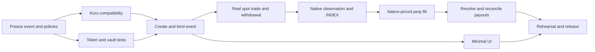

# Native market implementation tracker

Updated: **2026-10-13** · Initial implementation baseline: **`df8b01c` / `feat/pricefeed`**.

Requirements: [nativemarket.md](../../nativemarket.md). Architecture and rationale: [NATIVE_MARKET_PLAN.md](NATIVE_MARKET_PLAN.md).

**Target:** one native binary event on Monad testnet, fully backed YES/NO tokens, real Kuru spot trading, native INDEX feeding an existing Eros perp, and correct spot/perp payouts. Existing external markets continue working.

**Current state:** the Kuru compatibility spike **passed on a local fork of Monad testnet**: Kuru accepts Eros TestUSDC as quote, market creation is permissionless, and its units match Eros lots and ticks exactly ([evidence](../../artifacts/native-market/20261013-kuru-fork-spike/kuru-compatibility.md)). Public receipts are still pending (NM-B06). Native contracts and services are not implemented. Existing perp/oracle/publisher infrastructure is reusable, but its existence does not close native integration tasks.

## 0. 10-hour delivery cut (governing scope, 2026-10-13)

The time budget is **10 hours total**. Every task row is either **core**, with status `TODO`/`READY`/`VERIFY`/`DONE`, or **`IF-TIME`**: deferred, still tracked, and picked up only from the list below once the core demo works. The P0/P1/P2 sections remain as reference; this section decides what gets built now.

### Core path, in hour order

| Hours | Block | Core tasks | Done when |
| --- | --- | --- | --- |
| 0–0.5 | Freeze inputs | A01, A02, A03, A05, A06 | Event text and slug written; T about 48 h out (the engine enforces at least 24 h); keys and test budget recorded |
| 0–0.5 | Kuru public smoke | B06 (B01–B04 passed on fork) | Fork spike script rerun against public testnet with funded keys; receipts recorded |
| 0.5–2.5 | Vault + tokens | C01–C06, C08, C09 | `forge test` passes: split/merge, sync (YES/NO/INVALID price), redeem, one conservation fuzz invariant |
| 2.5–4 | Deploy + bind + spot | D01–D06, E01, E02, E04, E06 | One script: vault → 2 Kuru books → registry listing (native signer/rules) → `bindMarket`; maker rests static quotes; a user buys YES |
| 4–6.5 | Native observer | F02–F08, F10 | YES book at a pinned block → VWAP at N → depth/spread/staleness checks → existing sign/relay → `PriceIngress` accepts; existing pricefeed tests still pass |
| 6.5–8 | Native perp | G01–G04 | Keeper + `makers.mjs` on native engine; windows warm; `activatePricing()`; one real 1× fill (avoid the hourly rollover) |
| 8–9 | Settlement (local) | H01, H02, H03, H07 | Foundry integration test with time warp: YES and non-0.5 INVALID; vault payout equals the engine price |
| 9–10 | Demo | J01, J05, J06, J07 | Touched test suites rerun; scripted demo rehearsed once and recorded; local vs live segments labeled |

Core simplifications, each tracked by an `IF-TIME` row:

- **Observer:** a parallel native entry point into the existing pipeline, not the `SourcePolicy` refactor (F01).
- **Deploy script:** not resumable after an interrupt; it fails loudly instead.
- **Maker:** static quotes with no cancel/replace loop; manual cancel at the end.
- **Demo:** CLI/scripted, with no frontend.
- **Settlement:** demonstrated only in local time-warped tests, because a newly listed market cannot reach T inside 10 hours.

### Never cut, even under time pressure

- Only the vault can mint or burn.
- Exact collateral backing, with one conservation invariant.
- Immutable market, token and unit binding.
- Real source timestamps.
- Rejecting empty, crossed, wide or stale books, including Kuru's empty-book sentinel `(uint256.max, 0)`.
- INVALID pays the engine's captured price.
- Spot and perp payouts agree.

### IF-TIME backlog, in pickup order

Pick from the top only after the core demo runs end to end. When starting one, change its row from `IF-TIME` to `ACTIVE`.

| # | Task(s) | Why it is next |
| ---: | --- | --- |
| 1 | NM-I03 (+ I01, I02 minimum) | Split/merge/redeem in the UI: the most visible demo upgrade |
| 2 | NM-I04, NM-I05 | YES/NO trade ticket and source/INDEX/MARK status in the UI |
| 3 | NM-E07 | Scripted complete-set arbitrage (0.70/0.40 and 0.45/0.45 examples) |
| 4 | NM-G05 | Show safe unavailability when native liquidity is pulled |
| 5 | NM-H04, NM-H05, NM-H06 | Dispute/VOID paths, perp claim preparation, Kuru-held token redemption |
| 6 | NM-C07, NM-B05 | Extra adversarial vault tests; Kuru FOK/minOut/insufficient-balance edges |
| 7 | NM-E03, NM-E05 | Maker inventory accounting; halt/shutdown automation |
| 8 | NM-G06, NM-G07 | Perp-only-change and rollover-recovery evidence |
| 9 | NM-F01, NM-F09 | `SourcePolicy` refactor; crash/reorg fault injection |
| 10 | NM-J02, NM-J03, NM-J04, NM-A04 | Supervisor enrollment, status page, recovery drills, baseline suite record |
| 11 | NM-I06, NM-I07, NM-I08, NM-J08 | Resolution UI, polish/E2E, post-demo handoff |

This is the working execution checklist. Update task rows as work happens; retain design rationale in the architecture plan. Paths described as **Add** are proposed files. Evidence paths are also proposed until a task supplies a real artifact.

## 1. Hackathon scope and working rules

| Priority | Meaning | Scheduling rule |
| --- | --- | --- |
| P0 — MUST BUILD NOW | Required capability or correctness check for the agreed demo | All A–J tasks are P0; reuse counts when the native integration is verified |
| P1 — NICE TO HAVE FOR HACKATHON | Useful improvement after the end-to-end demo works | Explicitly select from the optional backlog; otherwise deferred |
| P2 — PRODUCTION LATER | Stronger decentralization, economics, scale, or operational resilience | Outside hackathon delivery and completion counts |

Keep the MVP to one event, two ERC-20 outcome tokens, two Kuru books, one selected INDEX source per engine, one observer signer, and one operator host. Start native-priced perps at **1× with test collateral**. Keep periodic funding disabled. Reuse existing resolution with clearly labeled sandbox adjudication. A dedicated spot maker and the existing perp maker need separate funded inventories.

Do not build a new spot exchange, automatic source fallback, generalized source aggregation, an oracle signer network, governance framework, multi-region infrastructure, or outcome-token cross-margin. Ordinary funded quotes and direct RPC reads are sufficient. Automated arbitrage and a full native indexer are optional.

These correctness checks remain mandatory even under time pressure: collateral conservation, authorized mint/burn, market/token/unit binding, authentic observation times, stale/thin-book handling, finality checks, matching INVALID payouts, and recoverable user withdrawals/redemptions.

### How to maintain the tracker

- Set one task or a small coherent group to `ACTIVE`; record the person responsible in the owner table. One person may hold several roles.
- Work only after listed prerequisites are `DONE`; a `READY` task has no unfinished prerequisite. Independent local work can progress while a public-chain dependency is unavailable.
- Move to `VERIFY` when code exists but required tests or live evidence are missing. Move to `DONE` only after the row's completion check and shared definition of done pass.
- Use `BLOCKED` for a concrete obstacle and give it a blocker-register entry. Untested assumptions and normal unfinished dependencies stay `TODO`.
- Put a short evidence link in the task row. Capture test command, exit status, source revision and environment; for transactions, include chain, contract, hash, canonical block and relevant events/balance changes. Never attach secrets or credential-bearing RPC URLs.
- When a later change invalidates evidence, reopen affected tasks to `VERIFY`. Record why in the work log. A different deployed runtime is a new verification target.
- Update milestone status and completed counts from task rows. Do not count deferred work or pre-existing infrastructure as completed native work.

Statuses: `TODO`, `READY`, `ACTIVE`, `VERIFY`, `BLOCKED`, `DONE`, `DEFERRED`, `IF-TIME` (outside the 10-hour core; see section 0).

**Shared definition of done:** the scoped behavior exists; relevant positive/negative checks pass; no known collateral/finality/mapping blocker remains; the output is reproducible; evidence identifies what was actually tested; relevant config/docs are updated. No extra approval committee or independent-audit claim is required by this tracker.

## 2. Dashboard and ownership

| Workstream | What it delivers | Responsible role | Assigned person | Status | Core done / total |
| --- | --- | --- | --- | --- | ---: |
| A | Frozen event, policies, budget and baseline | Integration | Unassigned | READY | 0 / 5 core |
| B | Kuru compatibility proof | Integration | Unassigned | VERIFY (fork PASS) | 0 / 5 core |
| C | Backed YES/NO issuance and redemption contracts | Contracts | Unassigned | DONE (local) | 8 / 8 core |
| D | Bound native market and verified deployment | Integration + contracts | Unassigned | VERIFY (fork) | 0 / 6 core |
| E | Spot trading, maker liquidity and arbitrage demonstration | Venue integration | Unassigned | VERIFY (fork) | 0 / 4 core |
| F | Native observer and durable signed publication | Pricefeed | Unassigned | ACTIVE | 4 / 8 core |
| G | Native INDEX/MARK and real Eros perp execution | Perp integration | Unassigned | VERIFY (fork) | 0 / 4 core |
| H | Resolution, native redemption and perp claims | Contracts + oracle integration | Unassigned | ACTIVE | 1 / 4 core |
| I | Minimum usable native-market UI | Frontend | Unassigned | IF-TIME | 0 / 0 core |
| J | Operations, regression checks and demo handoff | Integration | Unassigned | ACTIVE | 0 / 4 core |
| **Core total** | **10-hour hackathon release** | Integration | Unassigned | **IN PROGRESS** (contracts, observer, local settlement done) | **13 / 48 core** (+26 IF-TIME) |

The 74 rows divide implementation and its acceptance checks into trackable pieces; they are not 74 separate features or services. Use them in coherent batches. The architecture plan's **8–12 engineering-day estimate** remains a rough core effort estimate, conditional on existing tools/test funds and a successful Kuru spike. Dates and people have not been assumed. Re-estimate after B and the first working publisher integration.

| Scheduling input | Current value | Updated by |
| --- | --- | --- |
| Hackathon submission/demo deadline | 10 hours of build time from 2026-10-13 (see section 0) | Integration |
| Available contributors and hours | Not recorded | Integration |
| Public-chain test budget | Not recorded; A05 | Integration |
| First complete local lifecycle target | Set after B06 | Integration |
| Testnet rehearsal target | Set after first complete local lifecycle | Integration |
| Feature freeze | Reserve final 20–25% of remaining time for verification/rehearsal | Integration |

### Start here

1. Complete **A01 and A02**: pin the existing stack and write the exact event/rules.
2. Finish **A03/A05/A06**: payout policy, capital budget and runtime roles.
3. Run **B01–B06** as a **4–8 engineering-hour Kuru spike**. Prove assets can return to their owner.
4. In parallel where staffing permits, build **C** locally using registry/engine fixtures; do not wait for frontend work.
5. Build the smallest scripted **D → E → F → G → H** lifecycle before UI polish.

## 3. Milestones and dependencies



The diagram shows the demonstrable delivery path. Individual dependency rows permit earlier contract settlement tests, UI scaffolding, and operational setup. Gate rows summarize work; they are not additional implementation tasks.

| Gate | Required task completion | Demonstrable result | State |
| --- | --- | --- | --- |
| M0 — venue choice proven | A01–A06, B01–B06 | Target-chain create → deposit → fill → cancel → withdraw works | OPEN |
| M1 — collateral correct | C01–C09 | Split/merge and redemption invariants pass locally | OPEN |
| M2 — native spot works | D01–D06, E01–E07 | Bound event, both books, actual spot trades and recovered inventory | OPEN |
| M3 — native source works | F01–F10 | Reproducible native evidence → signed receipt → complete INDEX | OPEN |
| M4 — native perp works | G01–G07 | Real perp fill; outage and epoch recovery verified | OPEN |
| M5 — payouts work | H01–H07 | YES/NO/INVALID/VOID checks and separate custody reconciliation | OPEN |
| M6 — users can complete it | I01–I08 | Wallet flow from split to trade to redeem/claim | OPEN |
| M7 — demo ready | J01–J08 and M0–M6 | Reproducible evidence, funded operators and a rehearsed presentation | OPEN |

## 4. P0 task register

All rows in this section inherit P0 and their workstream's owner. `—` under evidence means no evidence has been recorded. Test recipes, fixture names, and commands alone are not proof of completion.

### A. Freeze the event, operating limits and existing baseline

**Reuse/inspect:** [native plan](NATIVE_MARKET_PLAN.md), [public manifest](../../frontend/src/config/public-manifest.json), [IMarketConfig.sol](../../contracts/src/interfaces/IMarketConfig.sol), [PricingMath.sol](../../contracts/src/math/PricingMath.sol), [testnet operations](../integration/TESTNET_OPERATIONS.md).

**Add:** `docs/runbooks/NATIVE_MARKET_DEMO.md` configuration/decision section, `artifacts/native-market/<run>/baseline.json`. No protocol feature changes in A.

| Task | Status | Depends on | Work and completion check | Evidence |
| --- | --- | --- | --- | --- |
| NM-A01 | READY | — | Pin source revision and selected chain/registry/factory/oracle/vault/token/runtime identities; distinguish recorded manifest facts from fresh RPC verification. Inventory reusable services and existing user changes. | — |
| NM-A02 | READY | — | Write one unambiguous binary event: question, YES condition, NO condition, evidence source, timezone, T, early-halt eligibility, rules text/hash and namespaced slug. Use at least the required listing horizon; plan how settlement will be demonstrated. | — |
| NM-A03 | TODO | NM-A01, NM-A02 | Freeze token units, 1× perp policy, disabled funding, immutable issuance cap and source-selection policy. Specify YES/NO/INVALID/VOID payouts, including non-0.5 INVALID and delayed missing-history fallback. Record these in the decision register. | — |
| NM-A04 | IF-TIME | NM-A01 | Establish focused existing baseline checks for factory binding, sampling/windows, settlement and publisher behavior. Record commands/results and pre-existing failures separately. Confirm test tooling/ABI-generation commands. | — |
| NM-A05 | TODO | NM-A02, NM-A03 | Budget distinct collateral for complete-set backing, Kuru maker bids, perp participants/maker, required reserves and oracle bonds; budget MON per operator. Select N/spread/OI limits that funded spot and perp depth can support. | — |
| NM-A06 | TODO | NM-A01, NM-A05 | Record owner roles, dedicated key addresses, runtime versions, private env-file locations and durable journal directories. Define the canonical-read/receipt policy and the local versus public-demo modes. Keep secrets out of the tracker. | — |

**Hackathon shortcut:** one selected event and collateral, existing trust set and operator stack, no permissionless listing UI. An unavailable budget or signer is an operational dependency, not a reason to invent funded evidence.

### B. Prove Kuru compatibility before committing to it

**Add:** `scripts/native-market/kuru-spike.ts`, `packages/native-market/src/kuru-abi.ts`, `artifacts/native-market/<run>/kuru-compatibility.json`.

**Inspect/reuse:** pinned Kuru SDK/contracts referenced in the plan; existing deployment/RPC receipt-verification patterns. Vendor addresses are candidates until checked against the selected chain.

| Task | Status | Depends on | Work and completion check | Evidence |
| --- | --- | --- | --- | --- |
| NM-B01 | VERIFY | NM-A01, NM-A06 | Verify router and margin-account code on the selected chain, supported market type, SDK/ABI versions and events. Confirm the exact Eros collateral is usable; a different token sharing the symbol USDC is not equivalent. | PASS on local fork; public receipts pending (B06). [fork spike](../../artifacts/native-market/20261013-kuru-fork-spike/kuru-compatibility.md) |
| NM-B02 | VERIFY | NM-B01 | Deploy a disposable ERC-20/collateral market through the existing-token router route; record its parameters and creation receipt. Do not use a MON token-launch flow to manufacture outcome-token issuance. | PASS on local fork; public receipts pending (B06). [fork spike](../../artifacts/native-market/20261013-kuru-fork-spike/kuru-compatibility.md) |
| NM-B03 | VERIFY | NM-B02 | Deposit base/quote, place two funded limit sides, perform a real bounded trade from a second account, cancel remainder, withdraw balances. Verify each successful receipt and actual token deltas. | PASS on local fork; public receipts pending (B06). [fork spike](../../artifacts/native-market/20261013-kuru-fork-spike/kuru-compatibility.md) |
| NM-B04 | VERIFY | NM-B02 | Read parameters and encoded depth at one pinned canonical block. Verify integer decoding, token decimals, ticks, min/max size, probability-range precision and AMM-depth inclusion/exclusion against executable results. | PASS on local fork; public receipts pending (B06). [fork spike](../../artifacts/native-market/20261013-kuru-fork-spike/kuru-compatibility.md) |
| NM-B05 | IF-TIME | NM-B03, NM-B04 | Exercise insufficient balance, no liquidity, partial/FOK behavior and minOut/slippage failure. Verify which order/fill/cancel fields are indexed in the deployed ABI; prove withdrawal remains possible after cancellation. | — |
| NM-B06 | READY | NM-B03, NM-B04 | Public testnet smoke run of the fork spike (`R=<rpc>` with real funded keys), then record PASS or failed-spike decision with receipts, gas measurements, ABI/version pins and unresolved limitations. Within 4–8 engineering hours, choose Kuru or explicitly replan the venue; no hidden synthetic fallback. | — |

**Mocks:** disposable test tokens are acceptable for the spike. Mock books cannot close B03–B06's public compatibility requirement. If Kuru fails, alternative venue selection changes the scope and reopens affected task dependencies; it does not mark Kuru tasks `DONE`.

### C. Build the tokens and fully backed vault

**Add:** `contracts/src/native/OutcomeToken.sol`, `NativeOutcomeVault.sol`, minimal native read interfaces, `contracts/test/native/OutcomeVault.t.sol`, `OutcomeVaultInvariant.t.sol` and registry/engine test fixtures.

**Reuse:** [Solady](../../contracts/lib/solady/src), [settlement status interface](../../contracts/src/interfaces/IResolutionIngress.sol), [settlement controller](../../contracts/src/settlement/SettlementController.sol). Do not repurpose perp collateral custody for native backing.

| Task | Status | Depends on | Work and completion check | Evidence |
| --- | --- | --- | --- | --- |
| NM-C01 | DONE | NM-A03 | Implement standard six-decimal YES/NO ERC-20s with immutable market/side/vault identity and vault-only issuance/burning. Test balances, transfers, allowances and rejection of unauthorized mint/burn. | `FOUNDRY_PROFILE=ci forge test --match-path 'test/native/*.t.sol'` 35/35 pass, exit 0 (`260745b`) |
| NM-C02 | DONE | NM-C01 | Implement vault constructor and one-time permissionless market binding from the pinned registry. Check event, engine, collateral, oracle, rules and T. Reject arbitrary caller-supplied binding and operation while unbound. | `FOUNDRY_PROFILE=integration forge test --match-path test/integration/NativeSettlement.t.sol` 7/7 (local real registry/engine/oracle); binds to real `getMarketCore`. |
| NM-C03 | DONE | NM-C02 | Implement split: receive exact collateral, enforce outstanding-issuance cap and economic halt, mint equal YES/NO amounts. Enforce scheduled T even before a keeper materializes halt. No admin mint or issuance from donations. | `FOUNDRY_PROFILE=ci forge test --match-path 'test/native/*.t.sol'` 35/35 pass, exit 0 (`260745b`) |
| NM-C04 | DONE | NM-C03 | Implement merge: burn caller-owned equal amounts and return identical collateral atoms; allow backed complete-set exit after halt while resolution is pending, disable after native finalization. Test mixed owners/recipients and reverts. | `FOUNDRY_PROFILE=ci forge test --match-path 'test/native/*.t.sol'` 35/35 pass, exit 0 (`260745b`) |
| NM-C05 | DONE | NM-C02 | Implement resolution sync using bound engine finality/status. Translate enums explicitly; wait for INVALID price readiness. Latch one payout value/provenance; repeated identical sync is safe and conflicting values cannot replace it. | `FOUNDRY_PROFILE=ci forge test --match-path 'test/native/*.t.sol'` 35/35 pass, exit 0 (`260745b`) |
| NM-C06 | DONE | NM-C04, NM-C05 | Implement redemption with combined integer rounding for YES/NO amounts, exact complementary payout weights and caller-owned burns. Full sets redeem exactly; zero-payout losing tokens can be burned; retained dust cannot be swept by an admin. | `FOUNDRY_PROFILE=ci forge test --match-path 'test/native/*.t.sol'` 35/35 pass, exit 0 (`260745b`) |
| NM-C07 | IF-TIME | NM-C03, NM-C04, NM-C06 | Test reentrancy, failed/short transfers, unsupported collateral behavior, zero/oversized values, arithmetic limits, wrong token/market, receiver handling and rollback. Check transfers/withdrawals are not disabled at resolution. | — |
| NM-C08 | DONE | NM-C07 | Add conservation fuzz/invariant checks across split, transfer, merge, sync and fragmented redemption. Track donations and dust separately. Before finalization both supplies equal outstanding sets; total payouts never exceed backing. | `FOUNDRY_PROFILE=ci forge test --match-path 'test/native/*.t.sol'` 35/35 pass, exit 0 (`260745b`) |
| NM-C09 | DONE | NM-C08 | Compile with pinned settings, export ABI and run native contract tests/invariants. Record code/ABI identities, privileges and event/API documentation. Full-set round-trip and arbitrary INVALID payout examples pass locally. | `FOUNDRY_PROFILE=ci forge test --match-path 'test/native/*.t.sol'` 35/35 pass, exit 0 (`260745b`) ABIs: `artifacts/risk/native-outcome-vault-abi.json`, `outcome-token-abi.json` (`2deb124`, export `--check` exit 0). |

**Mocks:** local registry/engine finality fixtures are appropriate here. They exercise token/vault invariants early; real oracle and venue custody tests remain in H and E. Build no upgrade system or native factory for the first event.

### D. Deploy and bind one native event

**Add:** `scripts/native-market/deploy.ts`, `native-market.schema.json`, `packages/native-market/src/manifest.ts`, dedicated public native deployment manifest and resumable deployment journal.

**Reuse/change narrowly:** [oracle listing CLI](../../oracle/packages/oracle-cli/src/list.ts), [MarketRegistry](../../oracle/src/MarketRegistry.sol), [MarketFactory](../../contracts/src/factory/MarketFactory.sol), [deployment verification](../../scripts/verify-monad-deployment.py). Registry/factory contract changes are not planned.

| Task | Status | Depends on | Work and completion check | Evidence |
| --- | --- | --- | --- | --- |
| NM-D01 | VERIFY | NM-A03 | Define a versioned native manifest/schema for event, chain, collateral, vault/tokens, Kuru books, engine/listing, source policy, ABI/code hashes and deployment blocks. Separate public identities from private runtime config. | DeployNativeMarket JSON output + native rules manifest act as the native manifest; frontend/SDK manifest schema still to add with D06. [deploy rehearsal](../../artifacts/native-market/20261013-deploy-fork/README.md) |
| NM-D02 | VERIFY | NM-D01, NM-C09 | Implement resumable orchestration: vault/tokens → venue books → source rules → registry listing → verified engine binding. Simulate each action and journal receipts; partial deployment cannot enable UI trading or duplicate funded contracts. | `oracle/script/native/DeployNativeMarket.s.sol` (refuses rerun) + `ListNativeMarket.s.sol`; fork only. [deploy rehearsal](../../artifacts/native-market/20261013-deploy-fork/README.md) |
| NM-D03 | VERIFY | NM-D02, NM-B06 | Create both actual YES/collateral and NO/collateral books with verified bounds and fees, then produce their source bindings. No collateral issuance is enabled before successful binding. | YES/tUSDC and NO/tUSDC Kuru books created and verified on fork; public receipts pending. [deploy rehearsal](../../artifacts/native-market/20261013-deploy-fork/README.md) |
| NM-D04 | VERIFY | NM-D03, NM-A05, NM-F02 | Create the native event through the existing registry/factory with the validated native source signer/rules, 1× ceiling, funding disabled, appropriate OI cap and existing oracle setup. Verify bond commitment and factory/vault/listing handshake. | Listed through the real registry/factory on fork (impersonated lister), native source pinned, 1x, funding off, OI cap 1,000,000 lots. [fork rehearsal](../../artifacts/native-market/20261013-fork-rehearsal/README.md) |
| NM-D05 | VERIFY | NM-D04 | Bind the native vault to the registry-selected engine and verify every identity/rule/T/token field. Exercise wrong binding, duplicate listing and interrupted orchestration locally; resume public deployment without replacing live bindings. | `bindMarket()` latched the registry engine on fork; wrong binding covered by NativeSettlement.t.sol. [fork rehearsal](../../artifacts/native-market/20261013-fork-rehearsal/README.md) |
| NM-D06 | TODO | NM-D05 | Export and verify public manifest/ABIs and explicit native service configs. Confirm current runtime windows/carry and engine source pins. Existing external deployment selection remains available; native addresses are not blindly substituted globally. | — |

**Hackathon shortcut:** a script creates one event; no creator dashboard or generalized factory. Stop on mismatched immutable configuration; deploy a deliberately corrected fresh instance only with an accounted-for disposition of the earlier one.

### E. Trading, liquidity and complete-set arbitrage

**Add:** `packages/native-market/src/kuru-client.ts`, `maker.ts`, `units.ts`, focused tests, `scripts/native-market/trade.ts`, `arbitrage-demo.ts`.

**Reuse:** standard wallet signing/RPC utilities. [Existing makers.mjs](../../scripts/e2e/makers.mjs) remains the perp maker; it is not a native spot client.

| Task | Status | Depends on | Work and completion check | Evidence |
| --- | --- | --- | --- | --- |
| NM-E01 | VERIFY | NM-B04, NM-D01 | Implement integer-safe price/quantity/tick/lot conversions and fee-aware previews. Round buy/sell limits deliberately; reject unsupported precision/minimum size instead of silently changing intent. | Unit conversion in `packages/pricefeed/src/native/kuru.ts` (`toBook`), tested in `native-kuru.test.ts`; trade-side previews (buy/sell limits) still to do with E02. |
| NM-E02 | VERIFY | NM-E01, NM-D06 | Implement explicit approvals, margin deposit, bounded buy/sell, order status, cancellation and withdrawal. Reconcile actual receipts and deltas; handle rejected, partial and pending actions without duplicate transactions. | `scripts/native-market/spot.sh` deposit/quote/buy/sell/cancel/withdraw on real Kuru bytecode (fork). [fork rehearsal](../../artifacts/native-market/20261013-fork-rehearsal/README.md) |
| NM-E03 | IF-TIME | NM-E02, NM-A05 | Split maker inventory and independently fund quote bids and gas; account for inventory in wallet, vault backing and Kuru custody. Demonstrate neither native backing nor perp reserve funds maker spending. | — |
| NM-E04 | VERIFY | NM-E03 | Place/maintain two-sided quotes on both books with size/inventory/action/gas bounds and cancel/replace. Native quote inputs may not depend on the Eros perp's MARK/INDEX feedback. Restore outstanding-order state on restart. | Static two-sided maker quotes on both books via spot.sh (fork); no cancel/replace loop (10-hour cut). [fork rehearsal](../../artifacts/native-market/20261013-fork-rehearsal/README.md) |
| NM-E05 | IF-TIME | NM-E04 | Add halt/low-funds/shutdown behavior: stop new quotes, cancel known team orders, reconcile pending fills, preserve user withdrawals. Document that Eros does not control a global Kuru trading halt. | — |
| NM-E06 | VERIFY | NM-E02, NM-E04 | Execute real user YES and NO trades; show resulting balances, fees, remainder cancellation, withdrawal and a complete-set merge. Label controlled/team trades accurately; separate addresses are not proof of independent demand. | User bought 50 YES for 29 tUSDC on fork; public trade pending. [fork rehearsal](../../artifacts/native-market/20261013-fork-rehearsal/README.md) |
| NM-E07 | VERIFY | NM-E06 | Demonstrate executable over-parity split-and-sell and under-parity buy-and-merge examples in controlled fixtures/scripts. Account for both legs, fees/slippage/gas and residual inventory; do not claim midpoint-only profit or require an autonomous arb bot. | IF-TIME item done on fork: `scripts/native-market/arb.sh` buy-merge (0.56+0.43) and split-sell (0.57+0.44) each realized exactly +0.200 tUSDC on 20 sets, from balances; staged mispricing labelled. `bash scripts/native-market/fork-rehearsal.sh` (exit 0, twice) |

**Required liquidity:** N and spread come from A05/F02. Prove both native YES depth and Eros perp depth are funded; an empty book's existence does not pass the milestone. NO supports user trading/parity checks but is not a second independent INDEX source.

### F. Native observer and signed price publication

**Add:** `packages/pricefeed/src/source-policy.ts`, `native/{config,rules,kuru,collector,policy}.ts`, `test/native-*.test.ts`, retained native snapshot fixtures.

**Reuse/change narrowly:** [book arithmetic](../../packages/pricefeed/src/book.ts), [wire encoding](../../packages/pricefeed/src/wire.ts), [publication](../../packages/pricefeed/src/publication.ts), [durable pipeline](../../packages/pricefeed/src/durable-pipeline.ts), config/rules/service construction, packet/signing/relay journals and lifecycle checks.

| Task | Status | Depends on | Work and completion check | Evidence |
| --- | --- | --- | --- | --- |
| NM-F01 | IF-TIME | NM-A04, NM-D01 | Introduce tagged Polymarket/native source policies around collection/config/rules/preparation. Preserve Polymarket defaults, journal domains, wire format and network restrictions. Do not use fake Polymarket IDs or remove development admission guards. | — |
| NM-F02 | VERIFY | NM-D03, NM-A05, NM-F01 | Bind a distinct native rules-hash domain to YES orientation, exact books/tokens/collateral, N, spread, rounding, timestamps, confirmations and publication policy. Validate matching listing inputs and native manifest hashes before immutable engine creation. | `src/native/rules.ts` + `verifyNativeListing`; tests pass. Final hash depends on deployed addresses (D03/D04). |
| NM-F03 | DONE | NM-B04, NM-F02 | Read all required market/depth data at one canonical block and retain raw evidence/hash/timestamp. Reject inconsistent block snapshots, stale RPC responses and changed deployment/market parameters. | `readKuruSnapshot`: one pinned block, header hash rechecked; real Kuru bytes decoded on fork ([evidence](../../artifacts/native-market/20261013-observer-fork/README.md)). |
| NM-F04 | DONE | NM-F03, NM-E01 | Normalize executable YES-book depth into existing WAD/lot units; compute N-sized bid/ask VWAPs with conservative rounding and midpoint floor. NO stays diagnostic. Avoid double-counting AMM depth. | Reuses `summarizeBook`; hand-computed VWAP tests; fork check bid 0.4 / ask 0.6 / mid 0.5. |
| NM-F05 | DONE | NM-F04 | Validate both sides, N, uncrossed book, tick/price bounds, maximum spread and timestamp ordering/age. Add corrupted/wrong-market/wrong-decimal/endpoint/empty/thin/wide/crossed fixtures and deterministic expected arithmetic. | `inspectNativeSnapshot`: thin/empty/crossed/wide/out-of-domain/wrong chain-book-pair-decimals tests (`native-kuru.test.ts` 8/8). |
| NM-F06 | DONE | NM-F05 | Enforce source-second deduplication and authentic time; distinguish fresh invalid-depth evidence from transport failure. Expire stale packets, retain gaps and prevent cache retimestamping or observer-side guessed prices. | Same source second withheld, stale withheld, backwards quarantined, invalid-depth zero-price checkpoint (`native-publication.test.ts`). |
| NM-F07 | VERIFY | NM-F06 | Connect native evidence revalidation and preparation to existing packet store, signer fences, sequence/digest reservation and relay/receipt logic. Recheck destination code/listing before sending; signature must bind correct chain and engine. | `prepareNativeObservation` → existing PacketStore + `signPrepared`, signature recovers (13/13). Real PriceIngress acceptance pending F08/G02. |
| NM-F08 | VERIFY | NM-F07, NM-D06, NM-E04 | Enroll an explicit native testnet service and publish accepted observations from funded actual venue state. Verify sequence, original source time, impact fields, rules hash and complete INDEX coverage against engine reads. | `native-publish.js` → real engine on fork: seq 1–43 accepted, INDEX 0.565/0.61 available, invalid-depth on quote removal, recovery. Public run pending keys. [fork rehearsal](../../artifacts/native-market/20261013-fork-rehearsal/README.md) |
| NM-F09 | IF-TIME | NM-F08 | Test crash/restart, duplicated worker, missing/inconsistent signer journal, pending nonce/receipt, canonical block replacement and expired packets. Resume safely or stop with an actionable reason; never clear state blindly. | — |
| NM-F10 | TODO | NM-F09 | Run native adapter/ingress tests and affected existing Polymarket publication/worker/durable-pipeline tests. Native and external sources coexist; no automatic fallback or history splicing. Record source health and observation-age diagnostics. | — |

**Mocks:** retained book/RPC fixtures for deterministic tests; a real engine for envelope acceptance; actual target venue for F08. The first source is YES impact midpoint, then existing on-chain TWAP. No new on-chain router or second TWAP layer.

### G. Existing perps consuming native INDEX

**Add:** `oracle/test/integration/NativePriceLifecycle.t.sol`, `scripts/native-market/run.ts` local/testnet lifecycle modes.

**Reuse/change narrowly:** [BookRiskEngine](../../contracts/src/engine/BookRiskEngine.sol), [RegistryBookRiskEngine](../../oracle/src/integration/RegistryBookRiskEngine.sol), [market-services.ts](../../scripts/e2e/market-services.ts), [keeper-observer.ts](../../scripts/e2e/keeper-observer.ts), existing perp maker, activation and rollover policies. No risk-math rewrite is planned.

| Task | Status | Depends on | Work and completion check | Evidence |
| --- | --- | --- | --- | --- |
| NM-G01 | VERIFY | NM-D06, NM-A05 | Enroll a dedicated native engine into existing keeper/perp-maker tooling. Fund isolated trader/maker accounts and verify 1× ceiling, disabled funding, reserve policy and registry OI/depth headroom. | Perp accounts funded/allocated in real CollateralVault on fork. [fork rehearsal](../../artifacts/native-market/20261013-fork-rehearsal/README.md) |
| NM-G02 | VERIFY | NM-G01, NM-F08 | Prove authenticated INDEX warm-up and backed post-only quotes, then capture → newer INDEX → later-block seal of actual perp depth. Match deployed runtime semantics, including longer local default windows. | Keeper capture→seal of perp depth with fresh native INDEX on fork. [fork rehearsal](../../artifacts/native-market/20261013-fork-rehearsal/README.md) |
| NM-G03 | VERIFY | NM-G02 | Wait for complete INDEX/PERP/BASIS windows and all MARK candidates, then activate pricing where supported. Verify activation does not enable funding or staged calibration; no bootstrapping bypass. | PERP TWAP 0.61 available; `activatePricing()` → mode 1 on fork. [fork rehearsal](../../artifacts/native-market/20261013-fork-rehearsal/README.md) |
| NM-G04 | VERIFY | NM-G03 | Execute a real 1× perp fill against funded Eros liquidity. Reconcile order/fill/positions/cash and demonstrate close/reduce plus eligible release/withdrawal. Native tokens are not perp margin. | 1x fill long/short 50 claims, close, release, withdraw reconciled by hand on fork. [fork rehearsal](../../artifacts/native-market/20261013-fork-rehearsal/README.md) |
| NM-G05 | VERIFY | NM-G04, NM-F06 | Remove native liquidity or stop source publication; verify carry expiry, explicit unavailable state and restricted new risk. Missing MARK alone cannot justify normal liquidation. Recover by authentic new data and complete windows. | IF-TIME item rehearsed on fork: quote removal → invalid-depth checkpoints → INDEX unavailable → recovery. |
| NM-G06 | IF-TIME | NM-G04, NM-E04 | Change only perp orders and prove native observer evidence still comes from Kuru. Remove team spot depth and verify failed source eligibility; retain team-liquidity provenance. No claim that multiple team wallets establish independent pricing. | — |
| NM-G07 | VERIFY | NM-G05, NM-G06 | Cross one hourly rollover, complete account sweep/reopen, restore maker quotes and sealed history, then repeat a valid fill. Record any MARK interruption and actual recovery; preserve an existing external-market regression case. | IF-TIME item rehearsed anyway on fork: rollover + stale-INDEX block + recovery fill ([fork rehearsal](../../artifacts/native-market/20261013-fork-rehearsal/README.md)). |

**Mocks:** local controlled clock/chain fixtures may accelerate lifecycle tests; label them. Public evidence uses actual timestamps and deployed windows. Native leverage >1× belongs only to the optional gated task.

### H. Resolve the event and pay both systems correctly

**Add:** `oracle/test/integration/NativeSettlement.t.sol`, `scripts/native-market/settle.ts`, native/perp balance reconciliation artifact.

**Reuse:** [ResolutionOracle](../../oracle/src/ResolutionOracle.sol), [UmaAdapter](../../oracle/src/venues/UmaAdapter.sol), existing OOv3/sandbox, [committee console](../../oracle/services/committee-console), keeper, engine snapshot/payout preparation and native sync/redemption APIs.

| Task | Status | Depends on | Work and completion check | Evidence |
| --- | --- | --- | --- | --- |
| NM-H01 | TODO | NM-D04, NM-A02, NM-C05 | Configure the smallest existing proposal/assertion route with required trust set, evidence, bonds and liveness. Distinguish proposed/disputed/final states; label sandbox adjudication and authorized test roles. No new oracle network. | — |
| NM-H02 | VERIFY | NM-H01, NM-C09 | Exercise YES and NO through actual local registry/engine/oracle integration: final engine result → native sync → correct winning/losing redemption. Test unauthorized/premature sync and repeated calls. | `FOUNDRY_PROFILE=integration forge test --match-path test/integration/NativeSettlement.t.sol` 7/7 (local real registry/engine/oracle): YES/NO/rejected. Public sandbox run pending H01. |
| NM-H03 | DONE | NM-H02 | Exercise INVALID with complete non-0.5 history and with missing history/grace fallback. Native YES/NO weights must complement the engine's exact settlement price. Pending INVALID zero is not a finalized NO outcome. | `FOUNDRY_PROFILE=integration forge test --match-path test/integration/NativeSettlement.t.sol` 7/7 (local real registry/engine/oracle): INVALID 0.5 fallback after grace and complete-history 0.63 match engine exactly. |
| NM-H04 | IF-TIME | NM-H03 | Exercise dispute, rejection/retry, VOID deadline, early/scheduled halt and failed finality delivery. Unsettled assertions cannot redeem; conflicting finality cannot relatch. Preserve pre-T evidence and never backfill from post-T samples. | — |
| NM-H05 | IF-TIME | NM-H04, NM-G04 | Run snapshot and payout chunks and finish reconciliation before perp claims. Native sync/redemption needs finality/price, not completion of unrelated perp account paging. Test partial-progress restart and duplicate claim prevention. | — |
| NM-H06 | IF-TIME | NM-H05, NM-E05 | Reconcile native tokens held in Kuru orders/margin: cancel/withdraw, then redeem; reconcile perp balances separately. Aggregate payouts, residual liabilities and dust must fit each custody pool without cross-subsidy. | — |
| NM-H07 | TODO | NM-H06 | Record a complete settlement evidence bundle and honest presentation mode: accelerated local lifecycle, prepared matured event, or legitimately early-resolved event. Public transaction claims require actual public receipts; no shortened immutable T or synthetic past history. | — |

**Hackathon shortcut:** use the existing sandbox truth mechanism; provide local accelerated coverage for long deadlines. Do not promise full creation-to-expiry public execution inside a five-minute demo. A prepared recording must identify its environment and times.

### I. Minimal usable frontend

**Add:** `frontend/src/components/native-market.tsx`, `native-token-actions.tsx`, `frontend/src/lib/native-market.ts`, native manifest config and focused frontend tests.

**Change narrowly:** [deployment.ts](../../frontend/src/config/deployment.ts), [market metadata](../../frontend/src/config/market-metadata.json), [market discovery](../../frontend/src/lib/market-discovery.ts), [markets index](../../frontend/src/components/markets-index.tsx), appropriate route and SDK manifest validation. Read [frontend/AGENTS.md](../../frontend/AGENTS.md) and the relevant installed Next.js documentation before implementation.

| Task | Status | Depends on | Work and completion check | Evidence |
| --- | --- | --- | --- | --- |
| NM-I01 | IF-TIME | NM-D01, NM-A03 | Define native market read model and minimal Spot/Perp navigation. Represent wallet, Kuru available/locked, native claims and perp collateral separately. Only verified manifest bindings enable transactions. | — |
| NM-I02 | IF-TIME | NM-I01, NM-D06 | Add native discovery/labels/rules/expiry/selected-source information alongside existing external markets. Remove hardcoded external provenance for native entries; never enable unknown registry discoveries automatically. | — |
| NM-I03 | IF-TIME | NM-I02, NM-C09 | Implement connect/network checks, approve/split/merge with integer amounts, balances, issuance cap and actionable errors. Show pending/reverted/confirmed states and block accidental duplicate submissions. | — |
| NM-I04 | IF-TIME | NM-I03, NM-E06 | Implement YES/NO buy/sell with fee/slippage/minOut preview, available balances, partial fill feedback, order cancel and venue withdrawal. A successful wallet signature is not a confirmed trade. | — |
| NM-I05 | IF-TIME | NM-I04, NM-F08, NM-G04 | Display selected source, observation age/depth validity, INDEX/MARK readiness and spot/perp prices distinctly. Preserve existing perp ticket/transactions; unavailable prices never render as valid zero. | — |
| NM-I06 | IF-TIME | NM-I05, NM-H06 | Add halt/resolution/INVALID-wait states, native redemption and separate perp preparation/claim status. Guide cancellation/withdrawal of Kuru-held tokens before redemption; preserve exits when new trading stops. | — |
| NM-I07 | IF-TIME | NM-I06 | Add bounded event/receipt history and useful error/recovery labels; show test collateral, sandbox resolution and controlled liquidity provenance. Verify basic mobile layout, keyboard navigation and readable amounts. No charting redesign. | — |
| NM-I08 | IF-TIME | NM-I07, NM-H07 | Run focused UI tests, build/type checks and one wallet E2E for the full native path; verify wrong network, rejected approval, insufficient balance, stale source and duplicate click behavior. Existing external-market discovery/trading still works. | — |

**Mocks:** deterministic UI state fixtures are useful; one integration E2E must exercise real local contracts. Public smoke covers actual native/Kuru transactions. An attractive screenshot cannot close transaction-flow tasks.

### J. Operate, validate, rehearse and hand off

**Add:** native runbook sections, `scripts/native-market/status.ts`, redacted run/evidence manifests and demo sequence. Complete the runbook introduced by A.

**Change/reuse:** [market supervisor](../../scripts/ops/market-supervisor.mjs), [gas runway](../../scripts/ops/gas-runway.mjs), current RPC/restart policies, native journal/config enrollment and relevant test commands. Prefer the existing host/process approach.

| Task | Status | Depends on | Work and completion check | Evidence |
| --- | --- | --- | --- | --- |
| NM-J01 | VERIFY | NM-A06 | Prepare one durable operator runtime with explicit startup/shutdown commands, service roles, journal locations, log redaction, exclusive writers and key/env separation. Validate config without sending transactions. | Operator commands, roles, key/env separation and chain-sourced publisher sequencing documented in [runbook](../runbooks/NATIVE_MARKET_DEMO.md); public operator host not yet set up. |
| NM-J02 | IF-TIME | NM-J01, NM-F08, NM-E05, NM-G04 | Enroll native observer/spot maker plus existing perp maker/keeper; measure budgets and publication cadence. Keep required source/INVALID history and settlement work awake rather than tied to visitor activity. | — |
| NM-J03 | IF-TIME | NM-J02 | Provide a status command/page showing balances/gas, open orders, source age/validity, accepted sequence, INDEX/MARK, epoch work, oracle state and claim readiness. Distinguish process uptime from market usability. | — |
| NM-J04 | IF-TIME | NM-J03, NM-F09, NM-G07 | Rehearse worker restart, RPC outage, insufficient gas, pending transaction and bad identity. Verify bounded retries or safe stop, persistent state and actionable recovery. No automatic deletion of journal/nonce evidence. | — |
| NM-J05 | VERIFY | NM-C09, NM-F10, NM-G07, NM-H07, NM-I08, NM-J04 | Run scoped release regression across changed contracts, oracle integration, publisher, SDK/manifest and frontend. Record exact source/runtime/tool versions, commands, results and pre-existing failures; rerun affected checks after final changes. | Regression at `a57e4a5`: contracts `FOUNDRY_PROFILE=ci` 928/928 (exit 0); oracle integration 122/124 — the 2 failures (`test_createMarketEightKiBClaimWithinTransactionLimit`, `testBatch1024ParticipantsBoundedRolloverAndFullOracleClaims`) also fail on baseline `df8b01c` (pre-existing); native suites 35/35 + 7/7 + 13/13; ABI export check current. Final rerun due after public-run changes. |
| NM-J06 | VERIFY | NM-J05 | Rehearse split → real spot trade → native observation/INDEX/MARK → perp fill → resolution evidence → redeem/claim. Verify every advertised step's environment and receipts; measure time and top up within the recorded budget. | Whole flow rehearsed with one command on a Monad-testnet fork: deploy → list/bind → Timelock activate → spot → native INDEX → perp 1x → arbitrage. `bash scripts/native-market/fork-rehearsal.sh` (exit 0, twice). Public rehearsal pending keys/event. |
| NM-J07 | TODO | NM-J06 | Freeze the demo manifest and runbook; collect redacted receipts/screenshots/recording and known limitations. Provide exact start/status/recovery/stop commands and cleanly separate live portions from local or prior settlement evidence. | — |
| NM-J08 | IF-TIME | NM-J07 | Complete release checklist and asset/operator handoff: list remaining positions/orders, who maintains jobs through settlement, how funds exit, and post-demo shutdown conditions. Mark gates from actual evidence and record final scope/remaining work. | — |

## 5. Decisions and environment register

Fill exact values during A–D; a placeholder is not an operational config. Proposed values are design defaults, not measured safety guarantees.

| Decision | Selected policy / value to record | Owner task | State |
| --- | --- | --- | --- |
| Network and runtime | Monad testnet 10143 for public demo; local 31337 behavior tested separately; exact selected engine runtime pending | NM-A01 | VERIFY DURING SETUP |
| Event semantics | One binary event; exact wording, rules hash, slug, T/timezone and permissible early-resolution route pending | NM-A02 | OPEN |
| Settlement presentation | Choose local accelerated lifecycle or prepared legitimately resolved public event; label each segment | NM-A02, NM-H07 | OPEN |
| Outcome standard | Two six-decimal ERC-20s, one immutable vault | NM-A03 | PLANNED |
| Collateral identity | Same specific six-decimal collateral token as the selected Eros stack; verify Kuru accepts it | NM-A01, NM-B01 | OPEN |
| Issuance ceiling | Immutable max outstanding complete-set atoms; exact funded value pending | NM-A03, NM-A05 | OPEN |
| Payout rule | YES 1, NO 0; INVALID equals captured engine price; NO complements YES; no arbitrary admin price | NM-A03 | PLANNED |
| Venue | Two Kuru collateral-quoted books after compatibility proof | NM-B06 | UNVERIFIED |
| INDEX selection | Native YES book for new native engine; preserve external-selected engines; no fallback/aggregation | NM-A03, NM-F02 | PLANNED |
| Price method | N-sized executable impact midpoint + existing engine TWAP | NM-F02 | PLANNED |
| N and spread | Start evaluation at N=100 claims/100,000 lots and maximum 0.05 spread; finalize from funded native and perp depth | NM-A05, NM-F02 | OPEN |
| Observation policy | Canonical pinned block timestamp; fresh collection around 5 s, publication around 15–20 s initially; finalize age/headroom/confirmation limits from runtime and gas | NM-A06, NM-F02 | OPEN |
| INDEX/book carry | Read verified runtime; baseline source has 120 s INDEX / 300 s book on 10143 and 30 s each on 31337; do not assume old deployments match | NM-D06 | UNVERIFIED |
| Native perp risk | 1× ceiling, funding disabled, small registry OI cap with N-sized depth headroom | NM-A03, NM-G01 | PLANNED; OI VALUE OPEN |
| Resolution authority | Existing ResolutionOracle + UmaAdapter/OOv3 sandbox; exact trust set/evidence path/bond/liveness pending | NM-H01 | OPEN |
| Role separation | Spot maker, price signer/relay and perp maker have explicit permissions/keys; same team still means trusted test operation | NM-A06 | OPEN |
| Exposure/budget | Separate native backing, quote inventory, perp allocation, reserve requirement, oracle bonds and MON budgets | NM-A05 | OPEN |
| Public/private data | Public manifest/receipt hashes; secrets and signing databases restricted to runtime | NM-A06, NM-D06 | PLANNED |

## 6. Validation coverage matrix

This matrix maps failure cases to existing task rows; it does not add a second backlog. `NOT RUN` means no fresh native result is recorded. Use deterministic local tests for edge cases and actual target-chain receipts where the behavior depends on Kuru/deployed integration.

| Case | Required observable result | Task owners | Environment | Result |
| --- | --- | --- | --- | --- |
| Split → merge round-trip | Identical collateral atoms return; equal supplies/backing maintained | NM-C03, NM-C04, NM-C08 | Local contracts | NOT RUN |
| Unauthorized mint/burn or foreign owner redemption | Revert without supply/cash changes | NM-C01, NM-C07 | Local contracts | NOT RUN |
| Wrong registry/engine/event/collateral/T/rules | Cannot bind or publish; UI transaction path remains disabled | NM-C02, NM-D05, NM-F07, NM-I02 | Local + deployment reads | NOT RUN |
| Short transfer/reentrancy/donation/overflow | No unbacked issuance or unauthorized withdrawal; atomic rollback | NM-C07, NM-C08 | Local malicious token fixtures | NOT RUN |
| Issuance cap and halt boundary | Cap enforced, including before scheduled-halt materialization; merge/redemption exits preserved by lifecycle | NM-C03, NM-C04, NM-C07 | Local clock boundaries | NOT RUN |
| Tiny redemptions/non-0.5 weights | No overpayment; full-set combined redemption exact; dust retained | NM-C06, NM-C08, NM-H03 | Fuzz + local integration | NOT RUN |
| Kuru collateral/tokens/units | Exact supported pair and integer-scale execution; actual collateral returned | NM-B01, NM-B03, NM-B04 | Target-chain spike | NOT RUN |
| Partial/no fill, fees and minOut | Honest fill/remainder/fee state; protected minimum output; cancellation/withdrawal works | NM-B05, NM-E02, NM-E06 | Local vectors + target-chain trades | NOT RUN |
| Complete-set arbitrage | Profit only from executable legs after costs; residual inventory accounted | NM-E07 | Controlled fixtures/scripted executions | NOT RUN |
| Stale/cache/repeated-second source | No freshened old timestamp, duplicate elapsed weight or fabricated history | NM-F03, NM-F06 | Observer fixtures + real ingress | NOT RUN |
| Thin/empty/crossed/wide/out-of-range book | Invalid evidence or withheld packet, no usable fabricated INDEX | NM-F05, NM-F06, NM-G05 | Fixtures + liquidity removal | NOT RUN |
| Fresh unchanged book | New canonical block read may observe still-executable liquidity; cached response alone cannot | NM-F03, NM-F06 | Pinned-block fixtures | NOT RUN |
| Bad signature/sequence/rules/chain/engine | Correct rejection and intact publication journal | NM-F07, NM-F09 | Real local ingress | NOT RUN |
| Crash after sign/send, duplicate writer, reorg | Safe replay/reconciliation or explicit stop; no conflicting digest/nonce | NM-F09, NM-J04 | Fault-injected workers | NOT RUN |
| INDEX bootstrap and perp sample seal | All time/depth/source-order prerequisites required; no unmatched fake history | NM-G02, NM-G03 | Local real engine + public reads | NOT RUN |
| Native price/perp feedback | Changing only perp orders does not rewrite native venue evidence | NM-G06 | Integrated local/testnet scenario | NOT RUN |
| Hourly rollover and outage recovery | Bounded account progress, fresh maker quotes and restored valid windows | NM-G05, NM-G07 | Real engine with local clock + rehearsal | NOT RUN |
| Ordinary liquidation with unavailable MARK | Missing MARK alone cannot authorize it; retain separate endpoint/floor rules | NM-G05 | Real engine regression | NOT RUN |
| Proposed/rejected/disputed assertion | No premature redemption; retry/finality rules preserved | NM-H01, NM-H04 | Existing sandbox/oracle integration | NOT RUN |
| YES/NO/INVALID/VOID finality | Spot payout weights match bound engine; INVALID may wait for price | NM-H02, NM-H03, NM-H04 | Local complete lifecycle | NOT RUN |
| Perp preparation and claims | Both bounded preparation passes/reconciliation required; no double claim | NM-H05 | Real engine/vault | NOT RUN |
| Venue-held tokens at resolution | Cancel/withdraw/redeem route verified; no assumed global Kuru pause | NM-E05, NM-H06 | Target venue custody + local finality | NOT RUN |
| Separate pool conservation | Native backing never funds perp claims/maker bids/oracle bonds | NM-A05, NM-E03, NM-H06 | Balance audit | NOT RUN |
| Wallet rejected/pending/wrong network | Clear recoverable state, no duplicate action or phantom success | NM-I03, NM-I04, NM-I08 | Frontend tests + wallet E2E | NOT RUN |
| External market coexistence | Existing mapping, publication and frontend behavior preserved | NM-F10, NM-G07, NM-I08, NM-J05 | Existing regression + smoke | NOT RUN |
| Gas/RPC/service failure | Bounded retry or safe stop; honest source/market readiness | NM-J02, NM-J03, NM-J04 | Operator rehearsal | NOT RUN |

**Testing scope:** run targeted checks while implementing; run affected shared regression suites at the release checkpoint. Reuse existing risk mathematics/tests rather than adding implementation-mirroring tests for unrelated modules. Do not hold the hackathon for production throughput, multi-region failover or a new formal-verification program.

## 7. Blockers, risks and scope decisions

### Active blocker register

No execution blockers have been established yet. Kuru support, selected collateral compatibility and budgets are **unverified prerequisites**, not confirmed failures.

| Blocker ID | Related task | Exact obstacle / evidence | Responsible person | Next in-scope action | Resolution / date |
| --- | --- | --- | --- | --- | --- |
| — | — | No blocker recorded | — | Complete setup and Kuru spike | — |

When adding a blocker, explain what can still proceed independently. A deployment/venue blocker must not stop local accounting tests, fixed-point vectors or UI state models unnecessarily. A failed Kuru gate needs an explicit alternative selection and revised tracker, not an unannounced venue switch.

### Risks that affect the actual demo

| Risk | Hackathon treatment | Cannot claim / cannot cut | Task |
| --- | --- | --- | --- |
| Kuru version/pair/read API mismatch | Test it first; use pinned direct RPC/ABI | Hosted API availability is not assumed | NM-B01–NM-B06 |
| Insufficient inventory/gas | Fund and measure each role; small bounded market | A deployed empty book is not a trading demo | NM-A05, NM-E03, NM-J02 |
| Team controls all native liquidity | Allowed for labeled test-collateral 1× mechanics demo | No independent native-price or manipulation-resistant leverage claim | NM-G06 |
| Trusted signer and sandbox adjudicator | Reuse them and disclose actual trust | No decentralized oracle/DVM claim | NM-A06, NM-H01 |
| Short presentation versus event lifecycle | Prepare honest local/recorded settlement evidence | No fake historical prices or altered expiry rules | NM-A02, NM-H07 |
| Wrong INVALID policy | Read exact ready engine payout | Never assume all INVALID markets settle 50/50 | NM-H03 |
| Stale README/source/deployment assumptions | Pin runtime and compare config | Source code alone does not prove deployed behavior | NM-A01, NM-D06 |
| Failed service or epoch recovery | Reuse persistent state and rehearse recovery | Process alive does not mean INDEX/MARK available | NM-F09, NM-G07, NM-J04 |
| Third-party trading after Eros halt | Cancel team orders, stop our entry flow, preserve exits | No claim of protocol-wide Kuru pause | NM-E05, NM-I06 |
| Native oracle exposure grows beyond bonds | Cap issuance/test capital for demo | Current perp-based bonds do not establish coverage of all new spot value | NM-A03, NM-A05 |

### If time runs short

Cut in this order: all P1 work → native charts/full indexer → advanced maker strategy → live public presentation of long dispute/expiry paths (retain local integration evidence) → cosmetic UI work. Keep a small functional UI and the scripted end-to-end proof.

Do not cut correct backing, mint/burn authorization, withdrawals, timestamp/depth validation, binding verification, or payout consistency. If those do not work, label the result a partial prototype and name the missing milestone. A Kuru mock is not a substitute for the agreed Kuru demonstration.

## 8. Optional hackathon backlog — P1

All optional tasks start deferred. Activate only after M0–M6 are demonstrated and there is adequate rehearsal time. Record any exception and its cost in the work log. None of these tasks increases the core completion denominator.

| Task | Status | Prerequisite | Optional deliverable and acceptance | Evidence |
| --- | --- | --- | --- | --- |
| NM-X01 | DEFERRED | M0–M6 | Full native Envio history for issuance, trades and redemption; replay matches canonical receipts/balances. | — |
| NM-X02 | DEFERRED | M0–M6 | Automated complete-set arbitrage with inventory/slippage/gas bounds and both-leg failure handling. | — |
| NM-X03 | DEFERRED | M0–M6 | Native versus external comparison for genuinely matching event rules; display-only, no hidden averaging/fallback. | — |
| NM-X04 | DEFERRED | M0–M6 | Richer price/depth/history views; honest source/time/availability and simple mobile behavior. | — |
| NM-X05 | DEFERRED | M0–M6 | Kuru LP/flip-order integration with verified depth semantics and successful resolution-time inventory unwind. | — |
| NM-X06 | DEFERRED | M0–M6 | Native-priced leverage on a deliberate higher-cap listing only after independent economic-source evidence, measured depth/liquidation capacity, reserve, calibration and epoch activation. Reuse existing engine; test jumps/outages/failed liquidation and final conservation. If gate fails, retain 1×. | — |
| NM-X07 | DEFERRED | M0–M6 | Second native event using the same scripts/policies with isolated bindings and journals; no generalized factory required. | — |

## 9. Production backlog — P2

These are tracked to prevent accidental inclusion in MVP. They have no hackathon deadline and are not prerequisites for M7.

| Task | Status | Production improvement | Why deferred |
| --- | --- | --- | --- |
| NM-P01 | DEFERRED | Independent observer/signing quorum and safe key rotation | One dedicated trusted testnet signer demonstrates the flow |
| NM-P02 | DEFERRED | Aggregation, source fallback and history-safe governed migration | One immutable selected source avoids a new economic policy |
| NM-P03 | DEFERRED | Supported production oracle/DVM integration and monitoring | Existing sandbox assertion lifecycle is sufficient when disclosed |
| NM-P04 | DEFERRED | Manipulation-cost models, independent liquidity, calibrated OI/leverage and combined spot/perp bond policy | Controlled 1× test exposure avoids pretending those economics are established |
| NM-P05 | DEFERRED | Native factory, richer outcome families/ERC-1155 and composable conditions | One binary event needs neither generalized listing nor wrappers |
| NM-P06 | DEFERRED | Redundant observers/indexers/operators and multiple regions | Existing single-host durable operation plus recovery checks is enough |
| NM-P07 | DEFERRED | Governance/emergency procedures and reviewed upgrade/migration mechanisms | Fixed scoped contracts and existing authority model minimize new machinery |
| NM-P08 | DEFERRED | Periodic funding or cross-margin between native assets and perps | These are separate protocol changes, not adapter work |
| NM-P09 | DEFERRED | Independent contract/economic audit, extensive adversarial simulation and scaling analysis | Focus hackathon tests on new custody, source and settlement boundaries |

## 10. Evidence layout and acceptance checklist

Use one run directory per verified source/deployment combination. This is a suggested organization, not a requirement to produce a separate file for every task. A single well-structured run report can close multiple related tasks.

```text
artifacts/native-market/<run-id>/
  run.json                    # source revision, environment, versions, exact scope
  baseline.json               # selected existing identities and baseline results
  kuru-compatibility.json     # actual pair/ABI/unit/trade/withdraw proof
  deployment.json             # public identities, blocks, code/ABI/listing hashes
  tests/                      # commands, exit codes, test logs
  observations/               # redacted source evidence and reproducible summaries
  receipts/                   # canonical transaction/event and balance evidence
  reconciliation.json         # native backing/payouts; separate perp accounting
  demo.md                     # steps, durations, live versus recorded parts, limitations
```

Signing keys, authenticated RPC endpoints, full private runtime configs and signing databases remain outside the public artifact tree. Keep required recovery state in a private persistent runtime directory; publish only redacted evidence.

### Core release checklist

- [ ] Event semantics, source selection, payout rule and trust assumptions are visible and consistent across contract, manifest and UI.
- [ ] Token/vault accounting tests and invariants pass, including issuance cap, failed transfers and fragmented redemption.
- [ ] Actual Kuru pair creation, funded fill, cancellation and withdrawal are proven for the selected collateral/tokens.
- [ ] Native source mapping/decimals/depth/price/time are independently reproducible from retained evidence.
- [ ] Accepted native observations produce available INDEX/PERP/BASIS/MARK through existing engine readiness rules.
- [ ] A real 1× Eros perp fill uses the native-selected engine and balances reconcile.
- [ ] Native-source outage, worker restart and hourly rollover have been tested with honest unavailability/recovery.
- [ ] YES/NO/non-0.5 INVALID/missing-history INVALID/VOID/rejected-assertion paths pass; proposal is never treated as finality.
- [ ] Native redemption and perp claim values agree while their custody pools remain independent.
- [ ] Venue-held token withdrawal/redemption is covered; exits remain available after new trading stops.
- [ ] Minimum UI works through the wallet flow and existing external market behavior still passes regression checks.
- [ ] Manifest/runtime matches evidence; no keys or credential URLs appear in shared artifacts.
- [ ] Demo sequence is rehearsed with gas runway and accurate labels for controlled liquidity, sandbox adjudication and local/recorded settlement.
- [ ] Remaining positions/orders/jobs have an owner and documented completion/shutdown plan.
- [ ] All P0 task rows and M0–M7 gates reflect evidence; deferred work is listed separately.

**Demo success:** a viewer can follow where the collateral goes, how native tokens trade, how a qualified native price reaches Eros perps, and how both sets of claims get paid. The demo must not depend on describing an unfinished flow as operational.

## 11. Work log and next-session handoff

| Date | Work completed | Tasks affected | Validation / evidence | Remaining blocker / next step |
| --- | --- | --- | --- | --- |
| 2026-10-13 | Created tracker from native plan and requirements; implementation not started | All task rows initialized | Documentation consistency checks only; no native tests or transactions run | Start NM-A01 and NM-A02, then Kuru compatibility spike |
| 2026-10-13 | Cut scope to 10 hours (section 0): 26 rows moved to IF-TIME with pickup order. Ran the Kuru compatibility spike on a local anvil fork of Monad testnet: TestUSDC accepted as quote; permissionless `deployProxy`; deposit/post/fill/cancel/withdraw OK; units 1:1 with Eros lots and ticks | NM-B01–B04 → VERIFY; NM-B06 rewired to B03/B04; IF-TIME rows | `bash scripts/native-market/kuru-fork-spike.sh` exit 0 on fork block 70491754 ([evidence](../../artifacts/native-market/20261013-kuru-fork-spike/kuru-compatibility.md)); no public transactions | NM-B06 public smoke with funded keys; NM-A01–A06; start NM-C01 |
| 2026-10-13 | NM-C01–C09: OutcomeToken + NativeOutcomeVault (split/merge/bind/sync/redeem), unit/fuzz/invariant tests, ABI exports | C01, C03–C06, C08, C09 DONE; C02 VERIFY | CI-profile native suite 35/35 exit 0; ABI export check exit 0; commits `260745b`, `2deb124` | Pin real registry layout in NM-H02; next offline work: NM-E01 units, NM-F03–F06 observer |
| 2026-10-13 | Native observer (Kuru decode, rules, collector, packet builder) and real-stack settlement integration | F03–F06, H03, C02 DONE; E01, F02, F07, H02 VERIFY | pricefeed native tests 13/13; fork observer check; oracle `NativeSettlement.t.sol` 7/7; commits `094c538`, `a813015` + this | Needs keys/lister for D–G public work; offline next: Kuru trade client/maker (E02/E04) on fork, deploy script (D02) on local chain |
| 2026-10-13 | Full fork rehearsal on real Monad-testnet state: deploy vault+Kuru books, list via real registry (impersonated lister), bind, split, Kuru trades, native INDEX publishing into the real engine (0.565 → unavailable on quote removal → 0.61), keeper seal, `activatePricing`, 1x perp fill/close/release/withdraw | D01–D05, E02, E04, E06, F08, G01–G04 → VERIFY (fork) | commits `f7d7a39`, `f453fcb`, `0a13ab6`; evidence `artifacts/native-market/20261013-fork-rehearsal` | Public run needs: deployer/lister key, funded maker/observer/keeper keys, event text (A02). Then flip VERIFY→DONE with public receipts |
| 2026-10-13 | One-command fork rehearsal + arbitrage tool; publisher withholds on inconsistent reads (first run crashed once on `L2_BLOCK_MISMATCH` at anvil head; rerun clean, path not re-triggered) | E07, J06 → VERIFY (fork) | `1df1fab`; rehearsal exit 0 twice, 25 and 29 observations | Public run blocked on: event text, native role keys (avoid live supervisor keys), broadcast permission |

Use this handoff at the end of an implementation session:

```text
Source revision / deployed runtime:
Tasks moved to DONE (with evidence):
Tasks still ACTIVE or VERIFY:
Changed files / uncommitted work:
Commands run and exit codes:
Public transactions / pending receipts:
Open positions / resting orders / operator jobs:
Known failures and blocker IDs:
Next executable task:
Scope changes / optional work activated:
```

**Next executable tasks:** A02 event text + keys, then the public run in `docs/runbooks/NATIVE_MARKET_DEMO.md` (B06 → D02–D05 → E → F08 → G), then J06/J07. **First external-dependency decision:** NM-B06. **First product milestone:** M2, real native spot trading with recoverable assets. **First full Eros thesis milestone:** M5, native pricing → perp trading → consistent settlement, followed by UI/rehearsal.
