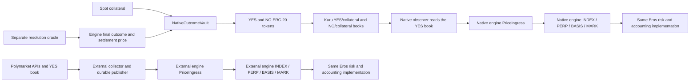

# Native market review — 13 October 2026

Reviewed source revision: `c4bea34`, plus the working tree. Scope: native outcome custody, Kuru execution, native observations/publication, the shared pricing and risk path, deployment/resolution scripts, frontend integration, demo workers, tests and local runtime evidence. This is an implementation review, not an independent economic audit. No market configuration or running worker was changed during this review.

**Assessment:** the native addition is a coherent, tested, fully backed testnet demonstration. A 30-second publisher interval alone does not establish safety or danger. The larger concerns are concentrated maker control, snapshot-based pricing, a short testnet averaging window with generous carry, one trusted signer and a simpler publication worker than the existing external-feed service. Keep the present 1×, funding-disabled scope until those concerns are addressed and measured.

**Architecture and the difference from the external pricefeed**

The two sources feed separate configured market engines. This diagram does not imply automatic aggregation, averaging or fallback between them. Both use the same observation format and pricing implementation.

| Aspect | Existing external path | Native path |
|---|---|---|
| Where spot trading occurs | Polymarket | Eros-issued tokens on Kuru |
| What Eros adds | An event perp using an external spot source | A complete-set spot market plus a perp using that spot source |
| Source reads | External event/market metadata and HTTP book data | On-chain Kuru YES-book reads at one pinned block |
| Source clock | Timestamp supplied in the external book response | Timestamp of the pinned chain block |
| Price calculation | Configured depth-N impact pricing | Shared depth-N impact VWAP calculation |
| Publication operations | Durable collection, packet, signing, transaction and relay journals | Simple native CLI reads accepted source sequence from the engine and sends a transaction |
| Oracle trust | Pinned signed reporter; the signature is not proof that the external book was honest | Pinned signed reporter; the signature is not proof of the Kuru snapshot |
| Eros pricing/risk | Shared engine | Same engine, native source pinned at listing |

Relevant source: [external collector](../../packages/pricefeed/src/collector.ts), [external worker](../../packages/pricefeed/src/worker.ts), [external service](../../packages/pricefeed/src/monad-service.ts), [native reader](../../packages/pricefeed/src/native/kuru.ts), [native collector](../../packages/pricefeed/src/native/collector.ts), [native CLI](../../packages/pricefeed/scripts/native-publish.ts).

**Native collateral, trading and settlement**

`NativeOutcomeVault.split()` deposits one collateral unit and issues one YES plus one NO. It checks the actual collateral received and the issuance cap. Only the vault can mint or burn the six-decimal ERC-20 outcome tokens. `merge()` burns the caller's equal YES/NO quantities and returns the corresponding collateral. The vault binds once to the engine selected by the registry, verifying market ID, exact rules hash, schedule and collateral.

`DeployNativeMarket` creates the vault/tokens and two Kuru books. `ListNativeMarket` lists the event through the existing registry, pins the native source/signer/rules and binds the vault. The listing script sets a 1× ceiling, funding off and forced-book liquidation capacity to zero. Those settings are deliberate scope constraints, not evidence that the source would support higher leverage.

The spot asset vault, Kuru margin account, perp collateral vault, perp reserves and oracle bond treasury are separate custody domains. Buying a spot YES token does not create a perp position; funding an Eros perp does not mint native YES/NO.

There is no contract equation forcing the two independent Kuru book prices to sum to one. Complete-set arbitrage provides the economic connection: if executable YES/NO bids total 1.10, split for 1.00 and sell both; if executable asks total 0.90, buy both and merge for 1.00. These are gross examples before costs. `arb.sh` demonstrates this with separate transactions and zero minimum-output arguments, so it is exposed to changed books, partial fills and failure between legs. It is not an atomic guaranteed-profit strategy.

Normal YES/NO redemption follows the separate resolution oracle, not a current market midpoint. `syncResolution()` takes no arbitrary payout argument: it reads the bound engine's accepted finality. YES pays 1 to YES, NO pays 1 to NO. INVALID waits for the engine's designated invalid settlement price; it is not always 0.5. Consequently, historical price integrity also matters to the INVALID payout path. Outcome-token transfers remain open after halt; Kuru is not globally paused by the Eros engine. Cancel/withdraw venue-held tokens before merging or redeeming them.

Relevant source: [vault](../../contracts/src/native/NativeOutcomeVault.sol), [tokens](../../contracts/src/native/OutcomeToken.sol), [deployment](../../oracle/script/native/DeployNativeMarket.s.sol), [listing](../../oracle/script/native/ListNativeMarket.s.sol), [arbitrage demo](../../scripts/native-market/arb.sh), [resolution demonstration](../../oracle/script/native/ResolveNativeEarly.s.sol). The current deployment is explicitly labelled as owner-controlled sandbox adjudication, not independently verified event truth.

**How native spot prices become INDEX and MARK**

1. `readKuruSnapshot()` reads market parameters, manual order depth and AMM-vault parameters at one block. It rechecks the block hash/timestamp and the L2 book's embedded block number. The default block tag is `finalized`.
2. `inspectNativeSnapshot()` verifies chain, book, YES/collateral orientation and decimals; uses the block timestamp as source time; requires time advancement and freshness; and reuses `summarizeBook(..., 'vwap')`.
3. The summary walks enough bids and asks to cover depth N, computes average sell/buy execution prices, then uses their midpoint. This is a depth-N impact midpoint, not last trade or a volume-weighted average of historical trades. NO-book and Kuru AMM-vault depth do not enter this INDEX source.
4. `prepareNativeObservation()` constructs the shared signed observation. Authentic thin, crossed or excessively wide books produce an invalid-depth checkpoint; stale or inconsistent reads are withheld. The native CLI signs and submits it.
5. `PriceIngress` checks source/signer/rules, signature domain, increasing sequence, timestamp ordering and signed price/depth consistency. It trusts the signer for provenance: there is no Kuru storage proof in the observation. The off-chain 30-second source-age check is distinct from these on-chain checks.
6. `ObservationStore` integrates samples over time. INDEX requires complete valid time coverage. PERP is separately sampled from the Eros perp book; BASIS is the sampled perp midpoint minus the instantaneous INDEX point. Perp samples are captured and sealed in a later block, with unchanged book/account/epoch fingerprints and a newer INDEX observation required for valid sealing.
7. `MARK = median(INDEX + BASIS_TWAP, PERP_TWAP, latest valid PERP sample)`, clamped around INDEX and into [0,1]. All candidates must be available, and normal pricing must be active. INDEX availability alone is insufficient.

Relevant source: [snapshot reader](../../packages/pricefeed/src/native/kuru.ts), [inspection](../../packages/pricefeed/src/native/collector.ts), [packet preparation](../../packages/pricefeed/src/native/publication.ts), [impact arithmetic](../../packages/pricefeed/src/book.ts), [ingress](../../contracts/src/pricing/PriceIngress.sol), [store](../../contracts/src/pricing/ObservationStore.sol), [perp sampling](../../contracts/src/engine/BookRiskEngine.sol), [MARK arithmetic](../../contracts/src/math/PricingMath.sol).

The same risk code consumes the resulting context for margin and admission. Missing INDEX prevents ordinary matched fills; missing normal MARK prevents leveraged admission and mark-based liquidation, while certain fully backed/banded operations remain possible with valid INDEX. Funding machinery exists but the current native listing disables it. Settlement uses accepted oracle finality, with separate spot and perp claims.

**The clocks: 30 seconds means several different things**

| Clock | Current implementation/evidence | Meaning |
|---|---|---|
| Native publisher delay | Public run record says 30 s; CLI interval is an argument | Sleep after a completed round; actual spacing also includes reads, signing and receipt wait |
| Measured publication spacing | Last five spacings in the local publisher log: 41, 40, 39, 40, 41 s | The nominal 30 s setting does not guarantee a 30 s feed |
| Native simulation maker loop | Default `MAKER_EVERY_MS=30000` | Recomputes/requotes the spot maker; separate from publication |
| Native keeper loop | Default `EVERY=90` seconds | Calls perp sampling/rollover; actual spacing includes transaction/RPC work |
| Frontend market reads | Refetch interval 4 s | Reads existing chain state; does not publish a fresh source observation |
| Source freshness at packet preparation | At most 30 s old, with 5 s requested publication headroom | Limits age of the newly read snapshot before signing |
| Testnet INDEX/PERP/BASIS windows | 60 / 60 / 60 s | Average horizons on chain ID 10143 |
| Testnet INDEX carry | 120 s | A valid source observation contributes coverage until replaced or expired |
| Testnet PERP/BASIS carry | 300 s | A sealed book sample can contribute coverage for up to five minutes |
| Default other-chain windows | 300 / 60 / 900 s, carries 30 s | Default code path, not a production safety certification |

The old ABI name `indexTwap300()` still reads the configured 60-second testnet window. An earlier conversation explanation of five-minute INDEX and fifteen-minute BASIS warmup described the default parameters, not the current Monad testnet settings. Source: [PricingMath](../../contracts/src/math/PricingMath.sol), [pricingWindows](../../contracts/src/pricing/ObservationStore.sol), [source time](../../packages/pricefeed/src/time.ts), [publisher loop](../../packages/pricefeed/scripts/native-publish.ts), [keeper](../../scripts/native-market/keeper-daemon.sh), [testnet decision](../integration/TESTNET_CARRY_DECISION.md).

**Risk findings and priorities**

| Finding | Evidence and implication | Priority / recommendation |
|---|---|---|
| Concentrated control of price discovery | A single maker can supply the whole qualifying book. Public rules require 100,000 lots = 100 claims per side with up to 0.05 impact spread. Meeting that test does not establish expensive manipulation or independent demand. | High before real collateral or leverage: measure manipulation cost relative to extractable perp value/OI and require independent competitive liquidity. Keep the demo scope disclosed. |
| Short snapshot-based TWAP | Each sampled quote is held until a later observation or carry expiry. A fleeting manipulated book at a sampling instant may receive more time weight than it actually existed for. At a 60 s horizon, a value held for 30 s gets approximately half the weight. | High for leverage: qualification over multiple blocks/dwell time, finer/event-triggered captures, and an averaging/carry policy tested against source jumps and adversarial quotes. Faster polling alone is not proof of safety. |
| Transport freshness differs from economic freshness | Native source time is a new block timestamp, even if every order is unchanged. `native-sim` intentionally leaves its final quotes resting by default. The local logs show the simulation maker ended while the publisher continued reporting a 0.497 midpoint. Those can be genuine executable quotes, but not evidence of continuing information discovery. | Explicit distinction in telemetry/UI; retain last book-change/independent-flow times. Decide whether information-age gating is needed rather than automatically invalidating all quiet executable books. |
| A trusted signer attests source data | Signature checks establish author, rules/domain and arithmetic, not the underlying Kuru book. `evidenceHash` is off-chain provenance, not a proof checked by the engine. Same basic reporter trust also exists in the external path. | Restrict the key and keep durable evidence now; independent reporters or stronger verification later. No signer rotation path exists in PriceIngress. |
| Native publisher operations are weaker than the external service | The actual CLI signs/sends directly; it does not call the durable packet/transaction/relay pipeline. It has no process lock, durable signed outbox, bounded cumulative gas budget or explicit canonical-finality receipt reconciliation. Duplicate acceptance is rejected on-chain, but concurrent processes can still sign different candidates for the same sequence. | Reuse the existing durable publication machinery. Add validated loop bounds, one writer, graceful shutdown, receipt reconciliation and gas/budget supervision. Do not copy the external market's journals into this distinct domain. |
| INDEX and MARK can diverge in availability | Native keeper logs repeatedly show `sample=ok`, `perp=false`, `index=true`, `mode=1`. A successful sample transaction can capture/discard work without producing valid PERP coverage. Static keeper quotes and gross nonempty books do not prove eligible depth. | High for a reliable demo: inspect eligible `bookDepth`, capture/seal events, source timing and epoch state; alert on coverage, not transaction success. The exact current PERP failure cause was not established in this review. |
| Independent YES and NO books can disagree | Only YES is read for INDEX. Split/merge enables arbitrage, but the demo arbitrage is manual/non-atomic and no continuous cross-book enforcement exists. | Add a visible executable complement-consistency diagnostic; do not quietly average or switch sources. |
| Resolution is semi-trusted | Existing registry/committee/attestor/sandbox settings are reused; the example early-resolution script submits team-signed labels. Spot backing does not establish correct event adjudication or adequate bonds for combined spot/perp exposure. | Explicit demo disclosure now; stronger event-evidence, dispute and bond policy before real stakes. |

The simulation maker uses a toy probability model driven by Kraken BTC/USD or a random walk, plus inventory skew; takers are randomized noise/momentum/contrarian agents. The Kraken input avoids a direct MARK-to-spot feedback loop, but simulated agents do not become independent economic participants just because real on-chain trades occur. Do not interpret a smooth chart as evidence that the probability model is calibrated. Source: [native simulation](../../packages/pricefeed/scripts/native-sim.ts).

For illustration, with healthy prior coverage at 0.50, a manipulated 0.90 source observation held for half a 60-second window can make INDEX roughly 0.70. This is arithmetic, not an demonstrated attack against the deployed market. If the actual book manipulation lasted less than that sampling gap, the observed TWAP can overstate its duration. A 120-second carry can allow a single held value to cover an entire 60-second window. MARK's band limits deviations from INDEX, so it does not repair a biased INDEX. Full backing limits insolvency exposure but does not prevent unfair execution or wrong price signals.

Uniswap's oracle documentation explains the general importance of liquidity and averaging duration to manipulation cost. Its block-accumulated AMM oracle is not identical to this sampled CLOB source, so its security properties cannot be transferred to Eros without analysis: [official oracle documentation](https://developers.uniswap.org/docs/protocols/v2/concepts/oracles). Kuru's official SDK documents its book and margin interfaces: [Kuru SDK](https://github.com/Kuru-Labs/kuru-sdk).

**Frontend and operational scope**

The frontend includes the native BTC market and an archived resolved block-height market, labels Kuru as the source and uses the same Eros perp terminal/read path. Dedicated native spot split/merge/Kuru trading remains in the CLI scripts; the existing terminal is not a complete spot-market UI. Current data refreshes are separate from on-chain publication and the keeper.

The native tracker contains stale introductory statements saying contracts are unimplemented, despite later work-log entries and the actual implementation. The runbook also contains a 7.3M sample-gas claim corrected in the public run record to roughly 478k measured gas; 7.3M was a configured maximum. Treat source, verified deployment identity and receipts as authoritative over inconsistent prose.

**Checks run for this review**

- Native TypeScript collector/publication suites: **13 passed**.
- Native contract unit/fuzz/invariant suite: **35 passed**, including collateral conservation and no-overpayment invariants.
- Native real-stack settlement integration: **7 passed**, including YES, NO, rejected proposals and non-0.5 INVALID.

These 55 passing checks support custody, binding and validation behavior. They do not demonstrate adequate manipulation cost, liveness under all failures or production readiness. No live adversarial attack, deployment bytecode comparison or fresh market transaction was performed for this review.

**Practical decision:** preserve complete-set custody and shared risk/settlement reuse; first harden native publication operations and fix/diagnose PERP coverage. Keep controlled liquidity, simulated activity, single-signer and sandbox resolution disclosures. Before enabling leverage or real collateral, establish independent liquidity and measured manipulation resistance, then select observation frequency, TWAP and carry together. Changing 30 seconds to 5 seconds addresses only one part of the problem.
